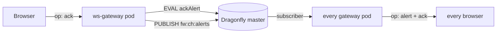

# Acknowledgement

An operator can acknowledge an alert from the UI. This document is the contract, the write path, and the failure behaviour.

## 1. What an ack is, and is not

An ack targets the **alert**, identified by `source:type` — the same key as `fw:alert:{key}` and the same row the UI shows. It is **not** a per-event flag: acking an event id would leave the alert row still firing, which is not what an operator means when they acknowledge.

| An ack means | An ack does not mean |
|---|---|
| "a human has seen this and is dealing with it" | "this is resolved" |
| the episode is claimed by `acked_by` | the condition has stopped |
| the row stays visible, marked | the row is hidden or deleted |

The ack is cleared automatically when the alert enters a **new episode** (§6). That distinction is the whole safety argument: an ack can never outlive the condition it was about.

## 2. Storage

Two fields on the existing alert hash, so no new keyspace and no new TTL policy:

| Field | Meaning |
|---|---|
| `acked_by` | operator label, ≤ 128 chars, sanitised |
| `acked_at` | epoch ms |

`fw:alert:{key}` already carries a 7-day TTL from the fold. An ack inherits it, which is correct: the ack is only meaningful while the alert row exists.

**Never created, only extended.** `ackAlert` refuses if the hash does not exist (`EXISTS` check inside the Lua). An ack written onto a missing hash would create a hash containing only ack fields — a row with no severity, no count and no timestamps, which every client would render as a phantom.

## 3. Protocol

Two new client frames and two new server frames, on the existing WebSocket. No new Route, no new service, no CORS.

Client → server:

```json
{ "op": "ack",    "key": "core-sw-07:link.down", "by": "gunnar" }
{ "op": "alerts", "keys": ["core-sw-07:link.down", "edge-gw-01:power.fault"] }
```

Server → client:

```json
{ "op": "alert",  "key": "core-sw-07:link.down", "ack": { "by": "gunnar", "at": 1762699200000 } }
{ "op": "alerts", "alerts": [ { "key": "core-sw-07:link.down", "ack": { "by": "gunnar", "at": 1762699200000 } } ] }
{ "op": "error",  "code": "no_such_alert", "message": "that alert no longer exists" }
```

Error codes: `bad_op`, `bad_key`, `bad_keys`, `too_many_keys`, `no_such_alert`, `ack_failed`, `alerts_failed`.

### 3.1 Why the client sends its own keys

`op: alerts` takes an explicit key list. There is deliberately no "list all open alerts" frame, because that would be `SCAN fw:alert:*` — the unbounded read the design refuses everywhere else ([websocket-server.md](websocket-server.md) §3). The client knows which alerts it is displaying, so it asks about exactly those. Capped at 200 keys per frame.

## 4. The write path



The gateway gained exactly one write: a named `ackAlert(hashKey, by, now, ttl)` method that runs a fixed Lua script. It is not a general write escape hatch — `dragonfly.js` still has no `set`, `del` or generic `eval`, so it cannot be used to modify events or indexes ([websocket-server.md](websocket-server.md) §5).

Four properties of that Lua, each deliberate:

| Property | Reason |
|---|---|
| `EXISTS` guard | never create an ack-only hash (§2) |
| first-ack-wins (`prevAt > 0` → return `already`) | two operators clicking at once cannot fight, and a second click can never silently re-attribute the ack |
| `HSET` of only `acked_by` / `acked_at` | `severity`, `count`, `last_seen`, `watermark` belong to the fold; touching them from the gateway would race it |
| `PEXPIRE`, never `PEXPIREAT` on a fresh key | extends the existing TTL, never invents one |

READONLY is handled like the worker does: re-resolve the master through Sentinel once, then fail and tell the client. A failed ack must never look like a successful one.

## 5. Propagation

The originator gets an `op: alert` frame with the ack immediately. Every other browser gets it via `fw:ch:alerts`, which all gateway pods already subscribe to — so a click reaches browsers on *other* pods with no pod-to-pod coordination and no sticky sessions ([websocket-server.md](websocket-server.md) §2).

Clients also re-read state in two cases:

| Trigger | Reason |
|---|---|
| reconnect | a client that was disconnected missed frames; the gateway has no per-client replay |
| displayed alert set changes (debounced 400 ms) | a newly-opened alert row needs its ack state |

## 6. Cleared on a new episode — the critical rule

The fold (`alert-fold.lua`) is the only writer of alert state, and it clears `acked_by` / `acked_at` in two places:

| Path | Why |
|---|---|
| retirement (`CLOSE` / `HARMLESS`) | the episode is over, so the claim on it is over |
| `fresh == 1` (a genuinely new occurrence after the dedup window) | this is a new episode and a new decision for a human to make |

Without the second `HDEL` the feature is actively dangerous: an operator acks a flapping link, it stops, it comes back six hours later, and the row reappears still marked *"acked by alice"* with nobody looking at it. That is a silent, plausible-looking lie on the screen — the worst failure mode this feature can have.

The frontend mirrors the same rule: an `op: alert` frame with `applied: 1` means the fold just counted a new occurrence, so the client drops its local ack for that key at that moment rather than waiting for the next debounced re-read. The fold's `HDEL` and the client's delete are the same decision made in two places, so they cannot drift.

## 7. Identity

Today `acked_by` defaults to `anonymous`: there is no authentication in front of the Route, so any value the client sends is a claim, not a fact.

When SSO lands, the label must come from the authenticated principal (an `oauth-proxy` sidecar, or an auth-enabled Route forwarding a header), **not** from the client frame. The change is confined to `validateAck` in `services/ws-gateway/src/ack.js`: the frame's `by` should then be ignored and the default should become a rejection. Nothing else in the write path needs to change.

Do not trust `by` for any authorisation decision in the meantime. It is an audit trail label, not a security control.

## 8. UI entry point

The action is a **right-click menu item**, not a button in the row. The `Ack` column shows state only.

| Where | Target key |
|---|---|
| Open alerts row | that row's `source:type` |
| Live events row | that event's `source:type` — the same alert |

Both entry points resolve to the same key and the same `op: ack` frame, so they cannot behave differently.

Why a menu rather than a button:

- acknowledging is a one-way claim on the episode, so it should not be one stray click away in a dense table
- the menu already opens on every row and already shows the record, so the action sits beside the evidence for it
- it keeps the alert table at 7 columns

An already-acked alert still shows the item, disabled and labelled `Acked by <name>`, so the menu does not change shape between rows.

### 8.1 Close, and bulk actions

The menu carries **Acknowledge**, **Close** and **Information**. Close is an
operator-initiated retirement, and it deliberately ends in the *same state a
CLOSE event from the source produces*:

| Write | Why it cannot be skipped |
|---|---|
| `DEL fw:alert:open:{key}` | otherwise the alert still reads as firing |
| `ZREM fw:idx:alert:open` | otherwise the snapshot resurrects a closed alert on every client's next page load — a phantom row nobody can clear |
| `HSET state=closed severity=CLOSE closed_by=… closed_at=…` | the record itself |
| `HDEL acked_by acked_at` | the ack belonged to the episode that has just ended |

All four happen in one Lua script, for the same reason the fold is atomic: a
crash between the hash write and the index removal leaves exactly the phantom row
above. Verified against Dragonfly: after the call, `state=closed`, the open flag is
gone and the index entry is removed.

The broadcast frame is `op: alert` with `applied: 3` — the same frame a
source-sent CLOSE produces — so clients retire the row through the path they
already have, with no new code path.

**Bulk actions.** Rows select with a plain click, `Shift+click` for a range and
`Ctrl/Cmd+click` to toggle, and a selection bar offers `Acknowledge N` and
`Close N`. Three rules:

- Bulk sends **one frame per key**, not a batched op. A batch would need its own
  partial-failure semantics ("3 of 5 closed, 1 already gone, 1 expired") for no
  gain: the per-key writes are already cheap.
- `Acknowledge` is **disabled** when every selected alert is already acked, and
  the label says how many are actually claimable — a range select can include
  rows another operator already took.
- Selection is filtered to keys **still on the board** before sending, so a bulk
  action never fires at an alert a source closed mid-selection.

Right-clicking inside a multi-row selection targets the whole selection; outside
it, targets that row alone. Otherwise the menu would contradict what the board
shows as selected.

## 9. Verification
```bash
# 1. ack an alert with a real client
node -e '
const WebSocket = require("ws");
const ws = new WebSocket("ws://127.0.0.1:30300");
ws.on("open", () => {
  ws.send(JSON.stringify({ op: "ack", key: "core-sw-07:link.down", by: "probe" }));
});
ws.on("message", (m) => { console.log(m.toString()); process.exit(0); });
'

# 2. the fields are on the alert hash, and nothing else changed
kubectl -n fire-watch exec dragonfly-0 -- redis-cli -p 6379 --no-auth-warning \
  HMGET fw:alert:core-sw-07:link.down acked_by acked_at severity count last_seen

# 3. a second ack is a no-op, not a re-attribution
#    expect the ORIGINAL acked_by/acked_at, unchanged

# 4. force a new episode (> FW_ALERT_DEDUP_WINDOW later, publish again)
#    expect acked_by and acked_at to be ABSENT
kubectl -n fire-watch exec dragonfly-0 -- redis-cli -p 6379 --no-auth-warning \
  HGETALL fw:alert:core-sw-07:link.down
```

Acceptance: the row is marked *and still visible*; a reload shows the ack without any local state; a re-fire shows the row un-acked.
