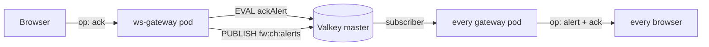

# Acknowledgement

An operator can acknowledge an alert from the UI. This document is the contract, the write path, and the failure behaviour.

## 1. What an ack is, and is not

An ack targets a **record**, addressed by its bare key — the same row the UI shows. It
is **not** a per-event flag: with one record per condition there is no per-event object
to flag, which is exactly why the ack lives as two fields on that hash
([valkey.md](valkey.md) §2).

| An ack means | An ack does not mean |
|---|---|
| "a human has seen this and is dealing with it" | "this is resolved" |
| the episode is claimed by `ackedBy` | the condition has stopped |
| the row stays visible, marked | the row is hidden or deleted |

The ack is cleared automatically when the alert enters a **new episode** (§6). That distinction is the whole safety argument: an ack can never outlive the condition it was about.

## 2. Storage

Two fields on the existing alert hash, so no new keyspace and no new TTL policy:

| Field | Meaning |
|---|---|
| `ackedBy` | operator label, ≤ 128 chars, sanitised |
| `ackedAt` | epoch ms |

`event:<key>` already carries a 7-day TTL from the fold. An ack inherits it (it is a field on the same hash), which is correct: the ack is only meaningful while the row exists.

**Never created, only extended.** `ackAlert` refuses if the hash does not exist (`EXISTS` check inside the Lua). An ack written onto a missing hash would create a hash containing only ack fields — a row with no severity, no count and no timestamps, which every client would render as a phantom.

## 3. Protocol

Two new client frames and two new server frames, on the existing WebSocket. No new Route, no new service, no CORS.

Client → server:

```json
{ "op": "ack",    "key": "core-sw-07:link.down", "by": "gunnar" }
{ "op": "alerts", "keys": ["core-sw-07:link.down", "edge-gw-01:power.fault"] }
```

Server → client:

```json
{ "op": "alert",  "key": "core-sw-07:link.down", "ack": { "by": "gunnar", "at": 1762699200000 } }
{ "op": "alerts", "alerts": [ { "key": "core-sw-07:link.down", "ack": { "by": "gunnar", "at": 1762699200000 } } ] }
{ "op": "error",  "code": "no_such_alert", "message": "that alert no longer exists" }
```

Error codes: `bad_op`, `bad_key`, `bad_keys`, `too_many_keys`, `no_such_alert`, `ack_failed`, `alerts_failed`.

### 3.1 Why the client sends its own keys

`op: alerts` takes an explicit key list. There is deliberately no "list all open alerts" frame, because that would be `SCAN event:*` — the unbounded read the design refuses everywhere else ([websocket-server.md](websocket-server.md) §3). The client knows which alerts it is displaying, so it asks about exactly those. Capped at 200 keys per frame.

## 4. The write path



The gateway gained exactly one write: a named `ackAlert(hashKey, by, now, ttl)` method that runs a fixed Lua script. It is not a general write escape hatch — `valkey.js` still has no `set`, `del` or generic `eval`, so it cannot be used to modify events or indexes ([websocket-server.md](websocket-server.md) §5).

Four properties of that Lua, each deliberate:

| Property | Reason |
|---|---|
| `EXISTS` guard | never create an ack-only hash (§2) |
| first-ack-wins (`prevAt > 0` → return `already`) | two operators clicking at once cannot fight, and a second click can never silently re-attribute the ack |
| `HSET` of only `ackedBy` / `ackedAt` | `severity`, `count`, `lastSeen`, `watermark` belong to the fold; touching them from the gateway would race it |
| `PEXPIRE`, never `PEXPIREAT` on a fresh key | extends the existing TTL, never invents one |

READONLY is handled like the worker does: re-resolve the master through Sentinel once, then fail and tell the client. A failed ack must never look like a successful one.

## 5. Propagation

The originator gets an `op: alert` frame with the ack immediately. Every other browser gets it via `fw:ch:alerts`, which all gateway pods already subscribe to — so a click reaches browsers on *other* pods with no pod-to-pod coordination and no sticky sessions ([websocket-server.md](websocket-server.md) §2).

Clients also re-read state in two cases:

| Trigger | Reason |
|---|---|
| reconnect | a client that was disconnected missed frames; the gateway has no per-client replay |
| displayed alert set changes (debounced 400 ms) | a newly-opened alert row needs its ack state |

## 6. Cleared on a new episode — the critical rule

The fold (`event-fold.lua`) is the only writer of alert state, and it clears `ackedBy` / `ackedAt` in two places:

| Path | Why |
|---|---|
| retirement (`CLOSE` / `HARMLESS`) | the episode is over, so the claim on it is over |
| `fresh == 1` (a genuinely new occurrence after the dedup window) | this is a new episode and a new decision for a human to make |

Without the second `HDEL` the feature is actively dangerous: an operator acks a flapping link, it stops, it comes back six hours later, and the row reappears still marked *"acked by alice"* with nobody looking at it. That is a silent, plausible-looking lie on the screen — the worst failure mode this feature can have.

The frontend mirrors the same rule: an `op: alert` frame with `applied: 1` means the fold just counted a new occurrence, so the client drops its local ack for that key at that moment rather than waiting for the next debounced re-read. The fold's `HDEL` and the client's delete are the same decision made in two places, so they cannot drift.

## 7. Identity

Today `ackedBy` defaults to `anonymous`: there is no authentication in front of the Route, so any value the client sends is a claim, not a fact.

When SSO lands, the label must come from the authenticated principal (an `oauth-proxy` sidecar, or an auth-enabled Route forwarding a header), **not** from the client frame. The change is confined to `validateAck` in `services/ws-gateway/src/ack.js`: the frame's `by` should then be ignored and the default should become a rejection. Nothing else in the write path needs to change.

Do not trust `by` for any authorisation decision in the meantime. It is an audit trail label, not a security control.

## 8. UI entry point

The action is a **right-click menu item**, not a button in the row. The `Ack` column shows state only.

| Where | Target key |
|---|---|
| Open alerts row | that row's record key |
| All events row | the record key that row belongs to |

Both entry points resolve to the same bare key and the same `op: ack` frame, so they
cannot behave differently. The key is carried on every frame and every query reply —
it is a hash of device + summary, so no client derives it
([valkey.md](valkey.md) §2).

Why a menu rather than a button:

- acknowledging is a one-way claim on the episode, so it should not be one stray click away in a dense table
- the menu already opens on every row and already shows the record, so the action sits beside the evidence for it
- it keeps the alert table at 7 columns

An already-acked alert still shows the item, disabled and labelled `Acked by <name>`, so the menu does not change shape between rows.

### 8.1 Close, and bulk actions

The menu carries **Acknowledge**, **Close** and **Information**. Close is an
operator-initiated retirement, and it deliberately ends in the *same state a
CLEAR event from the source produces* — including a real event record:

| Write | Why it cannot be skipped |
|---|---|
| `HSET event:<key> state=closed` (+ `closedBy`, `closedAt`) | otherwise the row still reads as firing |
| `ZREM idx:event:open` | otherwise the snapshot resurrects a closed row on every client's next page load — a phantom row nobody can clear |
| `ZADD idx:event:closed` | otherwise the **Closed tab cannot enumerate the closure at all** |
| `HDEL event:<key> ackedBy ackedAt` | an ack belongs to one EPISODE; a retired row must not come back still marked "acked by alice" |
| `HSET state=closed severity=CLOSE closedBy=… closedAt=… lastId=…` | the record itself, now pointing at the close event |
| `HDEL ackedBy ackedAt` | the ack belonged to the episode that has just ended |

All six happen in one Lua script, for the same reason the fold is atomic: a crash
between the hash write and the index removal leaves exactly the phantom row above.

**Why the event record is the interesting one.** An earlier version wrote only the
first, second and last rows — it flipped the hash and moved the indexes. The alert
disappeared and that looked correct, but the closure existed nowhere else: no
entry in the retention window, no summary, no author, and a gap in the audit
trail exactly where a human made a decision. It also could not appear in the
Closed tab, which enumerates from an index no part of that write maintained.

The record is a normal event with `severity: CLOSE` and
`payload.EVT_Severity: CLEAR`, so it flows through the same paths as a
source-sent retirement: the badge renders `CLEAR`, the fold treats it as a
retirement, and `EVT_Agent` names the operator because a human *is* the producer
in this case.

The id is `operator-clear-{sanitised-key}-{ms}` — deterministic, so a retried
close or two operators racing collapse onto one record instead of duplicating
history. `SET … NX` backs that up.

**Already-closed alerts.** A second operator clicking Close gets
`status: 'already'` plus the original author and timestamp. The first write wins;
nobody overwrites the record of who actually closed it.

The broadcast is two frames: `op: alert` with `applied: 3` (retire the row, the
same frame a source CLOSE produces) and `op: event` with `applied: 3` (show the
CLEAR in the live tail). The client also marks the Closed tab stale, so it
re-fetches on next open rather than after every single close in a bulk action.

**Bulk actions.** Rows select with a plain click, `Shift+click` for a range and
`Ctrl/Cmd+click` to toggle, and a selection bar offers `Acknowledge N` and
`Close N`. Three rules:

- Bulk sends **one frame per key**, not a batched op. A batch would need its own
  partial-failure semantics ("3 of 5 closed, 1 already gone, 1 expired") for no
  gain: the per-key writes are already cheap.
- `Acknowledge` is **disabled** when every selected alert is already acked, and
  the label says how many are actually claimable — a range select can include
  rows another operator already took.
- Selection is filtered to keys **still on the board** before sending, so a bulk
  action never fires at an alert a source closed mid-selection.

Right-clicking inside a multi-row selection targets the whole selection; outside
it, targets that row alone. Otherwise the menu would contradict what the board
shows as selected.

## 9. Verification
```bash
# 1. ack an alert with a real client
node -e '
const WebSocket = require("ws");
const ws = new WebSocket("ws://127.0.0.1:30300");
ws.on("open", () => {
  ws.send(JSON.stringify({ op: "ack", key: "<32-hex-key>", by: "probe" }));
});
ws.on("message", (m) => { console.log(m.toString()); process.exit(0); });
'

# 2. the fields are on the alert hash, and nothing else changed
kubectl -n fire-watch exec valkey-0 -- valkey-cli -p 6379 --no-auth-warning \
  HMGET event:<32-hex-key> ackedBy ackedAt severity count lastSeen

# 3. a second ack is a no-op, not a re-attribution
#    expect the ORIGINAL ackedBy/ackedAt, unchanged

# 4. force a new episode (retire it, then publish an occurrence again)
#    expect ackedBy and ackedAt to be ABSENT
kubectl -n fire-watch exec valkey-0 -- valkey-cli -p 6379 --no-auth-warning \
  HGETALL event:<32-hex-key>
```

Acceptance: the row is marked *and still visible*; a reload shows the ack without any local state; a re-fire shows the row un-acked.

## 10. Deleting an event — the one deliberate exception

`op: delete` removes a single event record **permanently**. It is the only
irreversible action in the system, and it knowingly bends the project's "no data
loss" rule (`AGENTS.md`). That is stated here rather than buried, because the rule
is otherwise absolute and a reader needs to know exactly where the exception is.

### 10.1 What it does, and what it cannot undo

```text
DEL  event:<key>                        the record
ZREM idx:event:all idx:event:open idx:event:closed  its index members
```

Both keys must go together. `ZADD` members never expire on their own, so a
leftover index entry is a **dangling id**: backfill reads it, finds no record, and
the event is silently missing from history in a way that looks like corruption
rather than like a deliberate delete.

What it does **not** touch, and why:

| Not touched | Reason |
|---|---|
| `event:<key>` and its `count` | The fold owns that number. A second writer decrementing it would race the fold and produce a count that disagrees with the stored state. The row's count therefore still includes the deleted event until the next fold write — an honest visible artefact rather than a silent corruption. |
| `journal:{key}` | Keyed by the record, and a LIST beside it rather than fields on it. The fold owns the hash and rewrites it atomically, so the notes live elsewhere and survive a record delete ([journal.md](journal.md) §2.1). |
| The RabbitMQ audit copy (`q.audit.events`) | It is a plain-text log written before the ack. There is no operator path to delete from it, so the event is **not** fully erased — only the queryable record is gone. Anyone relying on delete for compliance (GDPR-style erasure) must know this. |
| The Valkey AOF | The append log still holds the write that created the record until the next `BGREWRITEAOF`, which runs hourly. AOF replay after a crash inside that window can therefore resurrect a just-deleted record ([valkey.md](valkey.md) §4.2). |

So: gone from the board and from history, recoverable from the audit log by anyone
with broker access.

### 10.2 All three verbs address the same object

Ack, close and delete all take the bare record key now. They differ in EFFECT, not in
what they name:

| Verb | Effect |
|---|---|
| ack | two fields on the hash; the row keeps firing, marked as claimed |
| close | `state=closed`, and the key moves from the open index to the closed one |
| delete | the hash and its three index members are removed |

There is no ambiguity to resolve by naming an event id, because there is no longer a
separate per-delivery object to name ([valkey.md](valkey.md) §2).

The UI confirms before sending: a `window.confirm()` naming the id, deliberately
not a styled dialog, because a destructive action must not be dismissible by an
accidental outside click and must not look like the menu item above it. The menu
item itself is styled red (`inspector-danger`) for the same reason.

`op: delete` appears **only on event rows** (All events). Not on Open alerts.

| Row | Close | Delete |
|---|---|---|
| Open alerts | retire the condition | **not offered** |
| All events | retire the condition this row is | remove the record (it disappears from every tab) |

**Why an alert row has no Delete.** It was offered there for a while, scoped to
`a.event.id` — the newest record behind the row. It worked, and it was still wrong:

```
before: All events 219
Delete event  ->  deleted live-106
after:  All events 218
on screen: the alert row, its Count, its Summary — all unchanged
```

An alert with Count 113 has 113 records behind it. Removing one changes a list the
operator is not looking at, leaves the row and its count intact, and the fold owns the
count so it cannot even decrement. An action whose effect is invisible and whose scope
is surprising is worse than an action that is not offered.

The verbs are therefore split by what the row *is*: an alert is retired (**Close**) and
a record is removed (**Delete**), and each verb lives on the row type it acts on.

For a multi-row selection of events, Delete's label reports the resolved count
(`Delete 3 events`). The earlier version was gated on `a.event?.id && targets.length
=== 1`, so with 2+ rows selected it stayed ENABLED while every id failed to resolve —
a clickable item that silently did nothing. That is the "right-click Delete does not
work" report.

Close from an event row is offered because the operator is looking at an arrival and
may be concluding the incident from it; forcing a tab switch to Open alerts to act on
the same record key is friction for no reason. Its targets are **deduplicated by
record key**, so a selection of five rows across two conditions offers `Close 2 alerts`,
not `Close 5` — sending the same close five times would be one close reported as five.

**No confirmation dialog.** Delete used to open a `window.confirm()`, on the reasoning
that the only irreversible action should ask first. It was removed: reaching a delete
already takes right-click → menu → a red item naming the record, which is three
deliberate steps, and a native modal on top of that trains an operator to dismiss it
without reading. The red item naming the id *is* the confirmation.

### 10.3 Verification

```bash
# 1. find a record key
kubectl -n fire-watch exec valkey-0 -- valkey-cli -p 6379 --no-auth-warning \
  ZRANGE idx:event:all 0 0

# 2. delete it through the gateway (or right-click → Delete)
#    expect {"op":"deleted","id":"..."} and every client's tail drops the row

# 3. both keys are gone
kubectl -n fire-watch exec valkey-0 -- valkey-cli -p 6379 --no-auth-warning \
  EXISTS event:<32-hex-key>               # 0
kubectl -n fire-watch exec valkey-0 -- valkey-cli -p 6379 --no-auth-warning \
  ZSCORE idx:event:all <32-hex-key>        # (nil)

# 4. deleting again reports the truth instead of claiming success
#    expect {"code":"no_such_event"}
```

Verified against the lab cluster: record `1 → 0`, index score `1000 → nil`, second
delete `missing`.
