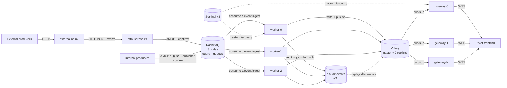

# Architecture

## 1. Purpose

`fire-watch` is an event ingestion and visualization platform. Producers publish events;
workers persist them; a WebSocket gateway streams them to a React front end.

## 2. Hard requirements (from `AGENTS.md`)

| ID | Requirement | Consequence |
|----|-------------|-------------|
| R1 | No data loss | Every accepted event must survive the loss of any single pod, node, or Valkey role change. See [persistence-and-durability.md](persistence-and-durability.md). |
| R2 | OpenShift target | Routes (not Ingress), SCC-aware security contexts, no privileged containers. |
| R3 | 100% H/A, 3 replicas per component, pods on different nodes | StatefulSets/Deployments with **required** pod anti-affinity, PodDisruptionBudgets on every component, readiness gates. Audited in [fault-tolerance.md](fault-tolerance.md). |
| R4 | Split-brain handling per component | RabbitMQ: quorum queues + `pause_minority`. Valkey: write guard + Service routing + Sentinel quorum. Gateway/workers: stateless. One residual gap documented in [fault-tolerance.md](fault-tolerance.md) §4. |
| R5 | Valkey manifests only (no Valkey operator) | Raw StatefulSet + Services + ConfigMap + Secret; role management via Redis Sentinel (see [redis-sentinel.md](redis-sentinel.md)). |
| R6 | WebSocket gateway scales horizontally | Stateless pods behind a Service, HPA on connection count. |

## 3. Components

| Component | Kind | Replicas | Stateful | Doc |
|-----------|------|----------|----------|-----|
| http-ingress | Deployment, NodePort 30900 | 3 | No | [http-ingress.md](http-ingress.md) |
| RabbitMQ | StatefulSet, quorum queues | 3 | Yes (PVC) | [rabbitmq.md](rabbitmq.md) |
| Valkey | StatefulSet, 1 master + 2 replicas | 3 | Yes (PVC) | [valkey.md](valkey.md) |
| Redis Sentinel | StatefulSet | 3 | No | [redis-sentinel.md](redis-sentinel.md) |
| Workers | Deployment | 3 | No | [workers.md](workers.md) |
| WebSocket gateway | Deployment + HPA | 3..N | No | [websocket-server.md](websocket-server.md) |
| Frontend | Deployment (static) + Route | 3 | No | [frontend.md](frontend.md) |

Namespace: `fire-watch`.

## 4. Data flow



Three independent paths exist by design:

1. **Durability path:** producer → RabbitMQ (quorum, on disk) → worker → Valkey → ack.
2. **Recovery path:** worker → `q.audit.events` → `replay-gap` Job → Valkey.
3. **Visualization path:** Valkey pub/sub → gateway → browser.

The HTTP ingress is a producer, not a consumer: it converts HTTP to AMQP and does not answer 202 until the broker has confirmed. Both producer paths end at the same exchange and routing key, so nothing downstream can tell them apart.

The gateway never touches RabbitMQ, and the durability path never depends on a browser being connected.

## 5. Message contract

Queue and routing keys are fixed so that the producer, worker, and gateway can be developed independently.

| Item | Value |
|------|-------|
| Exchange | `fx.events` (direct, durable) |
| Queue | `q.event.ingest` (quorum, durable) |
| Routing key | `event.ingest` |
| Dead letter exchange | `fx.events.dlx` (fanout, durable) |
| Dead letter queue | `q.event.ingest.dlq` (quorum) |
| Audit exchange | `fx.audit` (direct, durable) |
| Audit queue (WAL) | `q.audit.events` (quorum, 7-day TTL, `x-overflow: reject-publish`) |
| Envelope | JSON, see below |

```json
{
  "id": "uuid-v4",
  "source": "sensor-a",
  "type": "telemetry.temperature",
  "severity": "CRITICAL",
  "ts": "2026-11-09T12:00:00.000Z",
  "payload": {
    "msg": "disk failing",
    "msgc": "full detail block: stack trace, device report, ..."
  }
}
```

Rules:

- `id` is the idempotency key. Workers write with `SET` semantics keyed by `id`, so duplicate delivery is harmless.
- `severity` ∈ `FATAL | CRITICAL | WARNING | HARMLESS | CLOSE`. `HARMLESS` and `CLOSE` retire open alerts instead of opening one. Full semantics in [event-lifecycle.md](event-lifecycle.md).
- `payload.msg` is the **short** text; `payload.msgc` is the **complete** string (stack trace, device report). `msgc` is the field that drives memory cost and the one that gets compressed ([payload-and-compression.md](payload-and-compression.md)).
- `ts` is **producer-clock time**, used for display and producer correlation only — never for ordering inside the cluster.
- **Ordering uses the RabbitMQ-assigned arrival timestamp** (`headers.timestamp_in_ms`, set by `message_interceptors.incoming.set_header_timestamp.overwrite = true`). Producer clocks are not trusted for ordering. See [event-lifecycle.md](event-lifecycle.md) §2–3.
- Workers reject (and DLQ) messages that fail schema validation, with `x-error` header set.
- Every accepted event is also copied to `q.audit.events` before the worker acks, so Valkey can be rebuilt without AOF ([persistence-and-durability.md](persistence-and-durability.md) §4).

## 6. Valkey storage layout

| Key / channel | Type | Purpose | TTL |
|---|---|---|---|
| `event:<32 hex>` | hash | ONE record per CONDITION: payload fields, `state`, `severity`, `count`, `firstSeen`, `lastSeen`, `lastId`, ack and closure fields, `watermark` | `FW_EVENT_TTL` = 604800 s (7 days, see [sizing.md](sizing.md) §1) |
| `idx:event:all` | sorted set, score = **broker ts** ms, member = bare key | Global timeline. Backs All events, which cannot be answered from `idx:source:*` without a SCAN | pruned by the worker ([workers.md](workers.md) §4) |
| `idx:event:open` | sorted set, score = last activity ms | The open set, so a client can be given a snapshot without `SCAN event:*` ([websocket-server.md](websocket-server.md) §3.1) | members removed by the fold on retirement |
| `idx:event:closed` | sorted set, score = `closedAt` ms | The retired set, written by the same fold call that removes the key from the open index, so a key is in at most one of the two | 7d, via the worker's index prune |
| `idx:source:{device}` | sorted set, score = **broker ts** ms, member = bare key | Per-device timeline for the filtered tail | pruned to the same 7-day window |
| `journal:<32 hex>` | list | Operator notes, append-only | 7d, refreshed on append |
| `fw:ch:events` | pub/sub channel | Live event fan-out to gateways | n/a |
| `fw:ch:alerts` | pub/sub channel | Live **state** fan-out (occurrence, close, ack, journal, delete) | n/a |

**The bare key** is `sha256(EVT_Device + 0x1f + EVT_Summary)[0:32]`, computed in
[`services/worker/src/keygen.js`](../services/worker/src/keygen.js). See
[valkey.md](valkey.md) §2 for why the key is content-derived and why it is opaque.

There is **no separate alert object, and no fingerprint key**. One record per
condition means the state, the rollup and the dedup identity all live at the same
address — a repeat cannot create a second key, so nothing has to detect it.

Key-space notifications are deliberately avoided: Valkey supports only `Ex` notifications, which is not enough to build the UI index reliably.

### 6.1 What `ZADD` is and what it costs

The UI needs "give me the last 15 minutes from sensor-a" without scanning 302 million keys. That query needs a **sorted set**: a collection ordered by a numeric score, where you can ask for a range by score in O(log n).

```
ZADD idx:source:sensor-a 1762699200000 9f2b8c1e4d7a83be5c61024ffa9d3e07
     ^  ^                ^              ^
     |  |                |              member: the bare record key
     |  |                score: event ts in epoch milliseconds
     |  key: one sorted set per device
     command: "insert or update this member with this score"
```

Reading it back:

```
ZRANGEBYSCORE idx:source:sensor-a 1762698300000 1762699200000  -> bare keys, oldest first
# then, one pipeline of HMGETs over event:<key> for the fields the row needs
```

**Why a sorted set and not a plain list or set:** a set has no order (useless for time ranges), and a list can only be read from the ends, so an arbitrary time range requires walking it. The sorted set is the only structure that answers "score between A and B" without a full scan.

**What the score buys you:** the score is a float64, so an epoch-ms timestamp fits exactly until the year 287 396. No precision loss, no overflow.

#### Memory cost per member

Redis/Valkey store each sorted-set member **twice** — once in a hash table (for `ZADD`/`ZREM` by member) and once in a skiplist (for range queries by score):

| Part | Bytes |
|---|---|
| hash-table entry: dictEntry + pointer | ~32 |
| member string (32-hex key + sds header, rounded) | ~48 |
| skiplist node: score 8 + backward 8 + levels avg 1.33 × 16 | ~40 |
| **Total per member** | **≈ 120–150** |

So `ZADD` costs ~150 B per event **on top of** the stored payload. At 2 048 B events that is **≈ 7% overhead** — real, but not the driver. At 256 B events it would have been 60% overhead, which is why the event size changes the design calculus. At 1 000 events/min the absolute cost is ≈216 MB/day, i.e. negligible.

#### Why the score is not used for TTL

Sorted-set members have **no TTL**. Redis and Valkey expire keys, not members. `event:<key>` disappears on its own after 604 800 s, but the member in `idx:source:{device}` stays forever and points at a key that no longer exists. Left alone, the index grows without bound and eventually **outlives the payloads it indexes** — after a year the index is 52x the intended retention.

That is why §6.2 exists. It is not tuning; without it the capacity model in [sizing.md](sizing.md) is simply wrong.

### 6.2 Index pruning (mandatory)

Two viable approaches. The worker uses (A); (B) is the alternative if pruning proves operationally awkward.

#### A. Periodic trim inside the sorted set (used)

Every `FW_INDEX_PRUNE_EVERY` writes per source (default `1 000`), the worker issues one extra command:

```
ZREMRANGEBYSCORE idx:source:sensor-a -inf (now - 604800000)
```

This deletes every member whose score is older than 7 days. It is O(log n + m) where m is the number removed — cheap, because m is normally 0 or 1.

- Cost: at 16.7 writes/s, one prune per 1 000 writes per source is effectively free; even during a 500/s storm it stays ≈0.5 commands/s fleet-wide.
- A source that stops producing events is never pruned again, but it also never grows — a key with only old members is a few KB until it is deleted. Add a sweeper for dead sources if that matters (§6.2.C).
- A missed prune self-corrects on the next one. No coordination needed.

#### B. Time-bucketed keys (alternative)

Instead of one sorted set per source, use one per source **per hour**:

```
idx:source:sensor-a:1762699200     EX 604800 + 3600
```

Now TTL does the pruning: each bucket expires an hour after its retention window ends. No `ZREMRANGEBYSCORE`, no counter.

Trade-offs:

| | A. one set + trim | B. hourly buckets |
|---|---|---|
| Pruning mechanism | explicit command | TTL, automatic |
| Memory | ~150 B/member | ~150 B/member **+ ~100 B overhead per bucket** |
| Key count | 500 | 500 × 168 = **84 000** |
| Range query | one `ZRANGEBYSCORE` | up to 168 `ZRANGEBYSCORE` + merge |
| Backfill complexity | trivial | must iterate buckets, merge client-side |

At 500 sources B costs 84 000 keys — fine for Valkey, but it makes every backfill a multi-key merge in the gateway. A is simpler and measurably cheaper; B wins only if explicit pruning is unacceptable.

#### C. Or drop the index entirely

If the UI only ever shows a live feed plus "last N minutes", the gateway can backfill from the audit queue instead and the payload keys can be written with no index at all. That saves the 150 B/event (~7% at 2 KiB) and removes §6.2 completely — but every historical query becomes a RabbitMQ replay, which is a different latency class. Not recommended while `since`-based backfill is a product requirement.

#### How to verify it is working

```
# per source, never more than 7 days of events
ZCARD idx:source:sensor-a      # <= 1 000/min / 500 sources x 10 080 min = 20 160

# oldest member should never be older than the retention window
ZRANGE idx:source:sensor-a 0 0 WITHSCORES
```

## 7. Failure matrix

| Failure | RabbitMQ | Valkey | Gateway | Result |
|---|---|---|---|---|
| 1 worker pod lost | Unacked message redelivered | Unaffected | Unaffected | No loss, delayed processing |
| 1 gateway pod lost | n/a | Unaffected | Client reconnects to another pod | Client-side reconnect required |
| 1 Valkey replica lost | Unaffected | Master keeps writing; `connected_slaves` drops to 1 | Reads/writes continue | Degraded redundancy; alert at 1 |
| Valkey master lost | Unaffected | Sentinel promotes a replica (quorum 2/3) | Clients re-resolve master via Sentinel | Seconds of write stalls, no loss |
| 1 node lost (1 pod of each component) | Cluster stays quorate (2/3) | 1 replica gone, master still has 2 peers unless it was the master | Pod rescheduled onto a surviving node | Survives, degraded until reschedule |
| Network partition, Valkey master isolated | Unaffected | Master sees 0 replicas → write guard pulls it out of the Service; Sentinel promotes majority-side replica | Clients follow the new master | Split brain prevented, see [redis-sentinel.md](redis-sentinel.md) §6 |
| Full cluster power loss | Quorum queues recover from journal | The AOF loads (snapshot base + <= 32 MB tail); anything older is replayed from `q.audit.events` | Reconnect | RPO 0 for accepted events, see [persistence-and-durability.md](persistence-and-durability.md) |
| Valkey PVC wiped on all 3 pods | Unaffected | Empty on start; `replay-gap` Job refills the **full 7 days** from `q.audit.events` | Clients see a temporary gap | RPO 0 — the WAL and the retention window now match |

## 8. Cross-cutting rules

- **One writer per key path.** Only the Valkey master is written to; replicas are read-only and reject writes (`READONLY`).
- **Ack last.** Workers acknowledge an AMQP message only after (a) Valkey confirms the write, (b) the audit copy is confirmed, and (c) the write guard is not tripped.
- **No in-pod state.** Gateway and workers hold no authoritative state; anything they cache is reconstructible from Valkey.
- **Everything pinned.** Image digests, chart versions, and config are pinned in git. No `:latest` in any manifest.

## 9. Open decisions

Tracked in [roadmap.md](roadmap.md) §3. The two that block implementation:

1. **Valkey durability.** Valkey has no AOF implementation. R1 therefore depends on RabbitMQ acting as the write-ahead log. This must be accepted explicitly before manifests are written.
2. **Valkey role management.** Sentinel plus a small in-cluster bridge controller that applies roles and maintains the Service endpoint. Sentinel is the plan of record.
