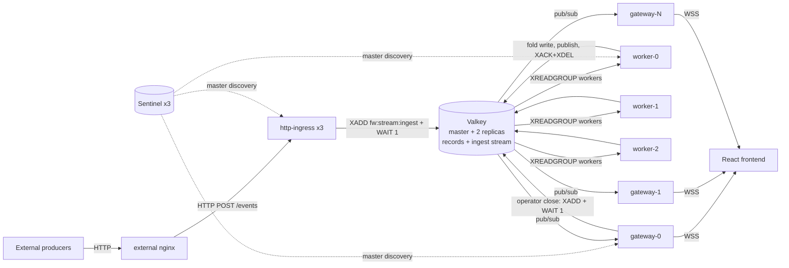

# Architecture

## 1. Purpose

`fire-watch` is an event ingestion and visualization platform. Producers publish events;
workers persist them; a WebSocket gateway streams them to a React front end.

## 2. Hard requirements (from `AGENTS.md`)

| ID | Requirement | Consequence |
|----|-------------|-------------|
| R1 | No data loss | Every accepted event must survive the loss of any single pod, node, or Valkey role change. See [persistence-and-durability.md](persistence-and-durability.md). |
| R2 | OpenShift target | Routes (not Ingress), SCC-aware security contexts, no privileged containers. |
| R3 | 100% H/A, 3 replicas per component, pods on different nodes | StatefulSets/Deployments with **required** pod anti-affinity, PodDisruptionBudgets on every component, readiness gates. Audited in [fault-tolerance.md](fault-tolerance.md). |
| R4 | Split-brain handling per component | Valkey (records **and** the ingest stream): `min-replicas-to-write 1` + `WAIT 1` + write guard + Service routing + Sentinel quorum 2/3. Gateway/workers/ingress: stateless. The residual window that `min-replicas-to-write 1` accepts is documented in [fault-tolerance.md](fault-tolerance.md) §4. |
| R5 | Valkey manifests only (no Valkey operator) | Raw StatefulSet + Services + ConfigMap + Secret; role management via Redis Sentinel (see [redis-sentinel.md](redis-sentinel.md)). |
| R6 | WebSocket gateway scales horizontally | Stateless pods behind a Service, HPA on connection count. |

## 3. Components

| Component | Kind | Replicas | Stateful | Doc |
|-----------|------|----------|----------|-----|
| http-ingress | Deployment, NodePort 30900 | 3 | No | [http-ingress.md](http-ingress.md) |
| Valkey | StatefulSet, 1 master + 2 replicas; holds the records **and** the ingest stream `fw:stream:ingest` | 3 | Yes (PVC, AOF on every pod) | [valkey.md](valkey.md) |
| Redis Sentinel | StatefulSet | 3 | No | [redis-sentinel.md](redis-sentinel.md) |
| Workers | Deployment | 3 | No | [workers.md](workers.md) |
| WebSocket gateway | Deployment + HPA | 3..N | No | [websocket-server.md](websocket-server.md) |
| Frontend | Deployment (static) + Route | 3 | No | [frontend.md](frontend.md) |

Namespace: `fire-watch`.

## 4. Data flow



Two paths exist by design:

1. **Durability path:** producer → nginx → http-ingress → `XADD fw:stream:ingest` + `WAIT 1` → 202 → worker (`XREADGROUP`) → fold write → `XACK`+`XDEL`.
2. **Visualization path:** Valkey pub/sub → gateway → browser.

The HTTP ingress is a producer, not a consumer: it appends the batch to the ingest stream in one `MULTI/EXEC` and does not answer 202 until the master accepted it (`min-replicas-to-write 1` satisfied) and `WAIT` saw a replica acknowledge it. The gateway's operator close appends to the same stream (`src operator`), so nothing downstream can tell the two producer paths apart except by that field.

The stream and the records live in the same Valkey, so there is no second stateful system to make H/A: the stream inherits Valkey's replication, AOF and Sentinel failover. The durability path never depends on a browser being connected.

> **History.** Up to 2026-11 the transport was a 3-node RabbitMQ cluster with quorum queues and an audit queue used as a write-ahead log. RabbitMQ was replaced by a Valkey stream and the audit copies were dropped; see [roadmap.md](roadmap.md) §4.

## 5. Message contract

Stream and group names are fixed so that the producers, worker, and gateway can be developed independently.

| Item | Value |
|------|-------|
| Ingest stream | `fw:stream:ingest` (`FW_STREAM_KEY`), never trimmed — its length is the backlog |
| Consumer group | `workers` (`FW_STREAM_GROUP`), created from ID `0` with `MKSTREAM` |
| Consumer name | the pod name (`POD_NAME`, downward API) |
| Dead-letter stream | `fw:stream:dlq` (`FW_STREAM_DLQ_KEY`), never trimmed |
| Entry fields | `evt` = the JSON envelope below; `src` = `http` \| `operator`; `cid` = the request's `x-request-id` (optional) |
| Entry ID | `<ms>-<seq>`, assigned by the master at `XADD`; its ms part is the event's `brokerTs` |

```json
{
  "id": "uuid-v4",
  "source": "sensor-a",
  "type": "telemetry.temperature",
  "severity": "CRITICAL",
  "ts": "2026-11-09T12:00:00.000Z",
  "payload": {
    "msg": "disk failing",
    "msgc": "full detail block: stack trace, device report, ..."
  }
}
```

Rules:

- `id` is the idempotency key. Workers write with `SET` semantics keyed by `id`, so duplicate delivery is harmless.
- `severity` ∈ `FATAL | CRITICAL | WARNING | HARMLESS | CLOSE`. `HARMLESS` and `CLOSE` retire open alerts instead of opening one. Full semantics in [event-lifecycle.md](event-lifecycle.md).
- `payload.msg` is the **short** text; `payload.msgc` is the **complete** string (stack trace, device report). `msgc` is the field that drives memory cost and the one that gets compressed ([payload-and-compression.md](payload-and-compression.md)).
- `ts` is **producer-clock time**, used for display and producer correlation only — never for ordering inside the cluster.
- **Ordering uses the arrival timestamp from the stream entry ID** (`<ms>-<seq>`, assigned by the master at `XADD`, monotonic). It is stored as `brokerTs`. Producer clocks are not trusted for ordering. See [event-lifecycle.md](event-lifecycle.md) §2–3.
- Workers move entries that can never succeed (unparseable `evt`, invalid envelope, malformed ID) to `fw:stream:dlq` with `origId` and `reason` fields, in the same `MULTI` that removes them from the ingest stream.

## 6. Valkey storage layout

| Key / channel | Type | Purpose | TTL |
|---|---|---|---|
| `event:<32 hex>` | hash | ONE record per CONDITION: payload fields, `state`, `severity`, `count`, `firstSeen`, `lastSeen`, `lastId`, ack and closure fields, `watermark` | `FW_EVENT_TTL` = 604800 s (7 days, see [sizing.md](sizing.md) §1) |
| `idx:event:all` | sorted set, score = **arrival ts** (`brokerTs`) ms, member = bare key | Global timeline. Backs All events, which cannot be answered from `idx:source:*` without a SCAN | pruned by the worker ([workers.md](workers.md) §4) |
| `idx:event:open` | sorted set, score = last activity ms | The open set, so a client can be given a snapshot without `SCAN event:*` ([websocket-server.md](websocket-server.md) §3.1) | members removed by the fold on retirement |
| `idx:event:closed` | sorted set, score = `closedAt` ms | The retired set, written by the same fold call that removes the key from the open index, so a key is in at most one of the two | 7d, via the worker's index prune |
| `idx:source:{device}` | sorted set, score = **arrival ts** (`brokerTs`) ms, member = bare key | Per-device timeline for the filtered tail | pruned to the same 7-day window |
| `journal:<32 hex>` | list | Operator notes, append-only | 7d, refreshed on append |
| `fw:stream:ingest` | stream + group `workers` | Ingest queue: entries in flight between XADD and the worker's XACK+XDEL | none; entries are deleted after the fold write, never trimmed |
| `fw:stream:dlq` | stream | Entries that can never succeed | none; operator inspects and deletes |
| `fw:ch:events` | pub/sub channel | Live event fan-out to gateways | n/a |
| `fw:ch:alerts` | pub/sub channel | Live **state** fan-out (occurrence, close, ack, journal, delete) | n/a |

**The bare key** is `sha256(EVT_Device + 0x1f + EVT_Summary)[0:32]`, computed in
[`services/worker/src/keygen.js`](../services/worker/src/keygen.js). See
[valkey.md](valkey.md) §2 for why the key is content-derived and why it is opaque.

There is **no separate alert object, and no fingerprint key**. One record per
condition means the state, the rollup and the dedup identity all live at the same
address — a repeat cannot create a second key, so nothing has to detect it.

Key-space notifications are deliberately avoided: Valkey supports only `Ex` notifications, which is not enough to build the UI index reliably.

### 6.1 What `ZADD` is and what it costs

The UI needs "give me the last 15 minutes from sensor-a" without scanning 302 million keys. That query needs a **sorted set**: a collection ordered by a numeric score, where you can ask for a range by score in O(log n).

```
ZADD idx:source:sensor-a 1762699200000 9f2b8c1e4d7a83be5c61024ffa9d3e07
     ^  ^                ^              ^
     |  |                |              member: the bare record key
     |  |                score: event ts in epoch milliseconds
     |  key: one sorted set per device
     command: "insert or update this member with this score"
```

Reading it back:

```
ZRANGEBYSCORE idx:source:sensor-a 1762698300000 1762699200000  -> bare keys, oldest first
# then, one pipeline of HMGETs over event:<key> for the fields the row needs
```

**Why a sorted set and not a plain list or set:** a set has no order (useless for time ranges), and a list can only be read from the ends, so an arbitrary time range requires walking it. The sorted set is the only structure that answers "score between A and B" without a full scan.

**What the score buys you:** the score is a float64, so an epoch-ms timestamp fits exactly until the year 287 396. No precision loss, no overflow.

#### Memory cost per member

Redis/Valkey store each sorted-set member **twice** — once in a hash table (for `ZADD`/`ZREM` by member) and once in a skiplist (for range queries by score):

| Part | Bytes |
|---|---|
| hash-table entry: dictEntry + pointer | ~32 |
| member string (32-hex key + sds header, rounded) | ~48 |
| skiplist node: score 8 + backward 8 + levels avg 1.33 × 16 | ~40 |
| **Total per member** | **≈ 120–150** |

So `ZADD` costs ~150 B per event **on top of** the stored payload. At 2 048 B events that is **≈ 7% overhead** — real, but not the driver. At 256 B events it would have been 60% overhead, which is why the event size changes the design calculus. At 1 000 events/min the absolute cost is ≈216 MB/day, i.e. negligible.

#### Why the score is not used for TTL

Sorted-set members have **no TTL**. Redis and Valkey expire keys, not members. `event:<key>` disappears on its own after 604 800 s, but the member in `idx:source:{device}` stays forever and points at a key that no longer exists. Left alone, the index grows without bound and eventually **outlives the payloads it indexes** — after a year the index is 52x the intended retention.

That is why §6.2 exists. It is not tuning; without it the capacity model in [sizing.md](sizing.md) is simply wrong.

### 6.2 Index pruning (mandatory)

Two viable approaches. The worker uses (A); (B) is the alternative if pruning proves operationally awkward.

#### A. Periodic trim inside the sorted set (used)

Every `FW_INDEX_PRUNE_EVERY` writes per source (default `1 000`), the worker issues one extra command:

```
ZREMRANGEBYSCORE idx:source:sensor-a -inf (now - 604800000)
```

This deletes every member whose score is older than 7 days. It is O(log n + m) where m is the number removed — cheap, because m is normally 0 or 1.

- Cost: at 16.7 writes/s, one prune per 1 000 writes per source is effectively free; even during a 500/s storm it stays ≈0.5 commands/s fleet-wide.
- A source that stops producing events is never pruned again, but it also never grows — a key with only old members is a few KB until it is deleted. Add a sweeper for dead sources if that matters (§6.2.C).
- A missed prune self-corrects on the next one. No coordination needed.

#### B. Time-bucketed keys (alternative)

Instead of one sorted set per source, use one per source **per hour**:

```
idx:source:sensor-a:1762699200     EX 604800 + 3600
```

Now TTL does the pruning: each bucket expires an hour after its retention window ends. No `ZREMRANGEBYSCORE`, no counter.

Trade-offs:

| | A. one set + trim | B. hourly buckets |
|---|---|---|
| Pruning mechanism | explicit command | TTL, automatic |
| Memory | ~150 B/member | ~150 B/member **+ ~100 B overhead per bucket** |
| Key count | 500 | 500 × 168 = **84 000** |
| Range query | one `ZRANGEBYSCORE` | up to 168 `ZRANGEBYSCORE` + merge |
| Backfill complexity | trivial | must iterate buckets, merge client-side |

At 500 sources B costs 84 000 keys — fine for Valkey, but it makes every backfill a multi-key merge in the gateway. A is simpler and measurably cheaper; B wins only if explicit pruning is unacceptable.

#### C. Or drop the index entirely

If the UI only ever showed a live feed, the payload keys could be written with no index at all. That saves the 150 B/event (~7% at 2 KiB) and removes §6.2 completely — but every historical query would become a `SCAN`. Not acceptable while `since`-based backfill is a product requirement.

#### How to verify it is working

```
# per source, never more than 7 days of events
ZCARD idx:source:sensor-a      # <= 1 000/min / 500 sources x 10 080 min = 20 160

# oldest member should never be older than the retention window
ZRANGE idx:source:sensor-a 0 0 WITHSCORES
```

## 7. Failure matrix

| Failure | Ingest stream | Valkey | Gateway | Result |
|---|---|---|---|---|
| 1 worker pod lost | Its pending entries are taken over by another worker with `XAUTOCLAIM` after 60 s idle | Unaffected | Unaffected | No loss, delayed processing |
| 1 ingress pod lost | In-flight request gets no 202; nginx retries on another pod | Unaffected | Unaffected | No loss |
| 1 gateway pod lost | n/a | Unaffected | Client reconnects to another pod | Client-side reconnect required |
| 1 Valkey replica lost | XADD keeps succeeding (`min-replicas-to-write 1`, `WAIT 1` met by the other replica) | Master keeps writing; `connected_slaves` drops to 1 | Reads/writes continue | Degraded redundancy; `ValkeyReplicaDown` warning |
| Valkey master lost | Replicated entries survive on the promoted replica; ingress answers 503 until the new master is resolved | Sentinel promotes a replica (quorum 2/3) | Clients re-resolve master via Sentinel | Seconds of 503s / write stalls, nginx retries, no loss of 202'd events |
| 1 node lost (1 pod of each component) | As above for the pods that were on it | 1 Valkey pod gone; writes continue with the 2 left | Pod rescheduled onto a surviving node | Survives, degraded until reschedule |
| Network partition, Valkey master isolated | XADD refused with `NOREPLICAS` → ingress 503 → nginx buffers | Master sees 0 replicas → refuses writes, write guard pulls it out of the Service; Sentinel promotes a majority-side replica | Clients follow the new master | Split brain prevented, see [redis-sentinel.md](redis-sentinel.md) §6 |
| Partition leaving old master with 1 replica while the majority sentinels promote the third pod | Writes to the old master are still accepted until clients re-resolve / the bridge withdraws its endpoint | Old master's writes discarded when it is demoted | Clients follow the new master | The accepted residual window of `min-replicas-to-write 1`, bounded by `WAIT 1` + bridge + nginx retry; see [fault-tolerance.md](fault-tolerance.md) §4 |
| Full cluster power loss | Stream entries are in the AOF like any other key | Each pod loads its own AOF (RDB base + <= 32 MB tail, `everysec`) | Reconnect | Every 202'd event was on 2 pods; see [persistence-and-durability.md](persistence-and-durability.md) §3 |
| Valkey PVC wiped on all 3 pods | Lost | Lost | Clients see empty tables | Data loss — no copy outside Valkey exists since the audit queue was dropped; restore from a volume backup |

## 8. Cross-cutting rules

- **One writer per key path.** Only the Valkey master is written to; replicas are read-only and reject writes (`READONLY`).
- **Ack last.** Workers `XACK`+`XDEL` a stream entry (one `MULTI`) only after Valkey confirmed the `hist:` fork and the fold write. Producers get 202 only after `XADD` succeeded and `WAIT 1` returned.
- **No in-pod state.** Gateway and workers hold no authoritative state; anything they cache is reconstructible from Valkey.
- **Everything pinned.** Image digests, chart versions, and config are pinned in git. No `:latest` in any manifest.

## 9. Open decisions

Tracked in [roadmap.md](roadmap.md) §3. Settled:

1. **Valkey durability.** AOF (`appendonly yes`, `appendfsync everysec`) on every pod, replication, `min-replicas-to-write 1`, and writers that `WAIT 1` before acknowledging. There is no copy of the data outside Valkey.
2. **Valkey role management.** Sentinel plus a small in-cluster bridge controller that applies roles and maintains the Service endpoint.
