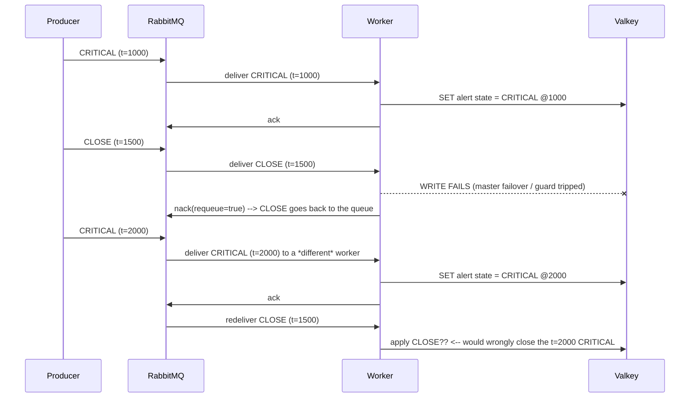

# Event Lifecycle: Severities, Ordering and Close Semantics

How an event becomes an alert, how a close retires one, and why redelivery must never make an old CLOSE retire a newer CRITICAL.

## 1. Severity levels

| Severity | Opens an alert | Closes open alerts | Notes |
|---|---|---|---|
| `FATAL` | yes | no | highest; never self-clears |
| `CRITICAL` | yes | no | |
| `WARNING` | yes | no | |
| `HARMLESS` | no | **yes** | benign termination (e.g. sensor recovered normally) |
| `CLOSE` | no | **yes** | explicit operator/system close |

Rule quoted from the spec: **a `HARMLESS` or `CLOSE` always closes the others if they exist.**

These are the *internal* severities. A producer does not send them: it sends the
`EVT_Severity` scale (`CRITICAL`/`MAJOR`/`MINOR`/`WARNING`/`INDETERMINATE`/
`INFORMATION`/`CLEAR`/`HARMLESS`) which the HTTP ingress maps down onto these five
before the event ever enters the broker. In particular a producer's `CLEAR` becomes
`CLOSE`, and `INFORMATION` becomes `HARMLESS` — see
[event-schema.md](event-schema.md) §3. The producer's original value is preserved as
`payload.EVT_Severity` but **nothing downstream reads it**; the fold only ever sees
the mapped internal severity.

Two consequences worth stating explicitly:

- `HARMLESS` and `CLOSE` are *not* severities in the same sense as the others — they are **retirement events**. They never create alert state of their own.
- All five still update the record at `event:<key>`; only a retirement changes its `state`.

## 2. The ordering requirement

Closing is inherently a comparison: "was this CLOSE after the CRITICAL it is closing?" That makes event order a correctness property, not a display detail.

The cluster must answer that question with **one total order all three workers agree on**. Two candidate clocks exist and only one is acceptable:

| Clock source | Problem |
|---|---|
| Producer clock (`ts` in the payload) | Every producer host has its own clock. Skew of a few seconds between hosts reorders events. Unfixable without PTP/NTP discipline across all producers. |
| **RabbitMQ broker clock** | A single authority per message, assigned when RabbitMQ accepts the message. All workers read the same value. |

Therefore: **ordering uses the RabbitMQ-assigned arrival timestamp, never the producer timestamp.** The producer's `ts` is retained for display and for producer-side correlation only.

## 3. Getting a broker timestamp

AMQP 0-9-1 has a `timestamp` message property, but it is **seconds** granularity and producers may set it themselves (or leave it empty). For millisecond ordering with no producer trust, have RabbitMQ stamp on arrival:

```ini
# rabbitmq.conf — required
message_interceptors.incoming.set_header_timestamp.overwrite = true
```

This sets both:

- the `timestamp` property (POSIX **seconds**), and
- the `timestamp_in_ms` header (**milliseconds**)

The default for `overwrite` is `false`, which *preserves* a producer-supplied value. **Set it to `true`**: with `false`, a producer with clock skew — or a malicious one — can forge its position in the ordering, and an old CLOSE could be made to look newer than a FATAL. Overwriting removes that entire class of problem.

This is the built-in replacement for the deprecated `rabbitmq_message_timestamp` plugin. That plugin targeted RabbitMQ ≤ 3.11 and the repository is archived; on 3.12+ use the config above. Never enable both — two interceptors on `basic.publish` break channel creation for every AMQP 0-9-1 connection.

Ordering key used by the worker:

```
broker_ts_ms = headers.timestamp_in_ms    (fallback: properties.timestamp * 1000)
```

If neither is present the message is a schema violation → `nack(requeue=false)` → DLQ.

## 4. The hazard: a redelivered CLOSE can kill a newer CRITICAL

This is the scenario the design must survive, written out precisely.



The bug is applying the CLOSE by *arrival* order instead of by *broker timestamp*. An old CLOSE redelivered late would retire a newer FATAL/CRITICAL/WARNING — silently losing an active alarm.

Note the same hazard exists without any failure at all: with **3 consumers on one quorum queue, RabbitMQ does not guarantee delivery order**. Two events published 10 ms apart can be delivered to different workers in the opposite order. Broker timestamps are what make the fold order-independent.

## 5. The fix: monotonic watermark per alert key

Every event carries a **broker timestamp**. The alert state for a given key is only advanced by an event whose timestamp is strictly newer than the last applied one.

### 5.1 Keys

| Key | Type | Contents | TTL |
|---|---|---|---|
| `event:<32 hex>` | hash | the WHOLE record: payload fields, `state`, `severity`, `count`, `firstSeen`, `lastSeen`, `lastId`, ack/closure fields, `watermark` | 7d (rolling) |
| `idx:event:open` | zset | member = bare key, score = last activity ms. The open set, so a client can be given a snapshot without `SCAN event:*` ([websocket-server.md](websocket-server.md) §3.1) | members removed by the fold on retirement |
| `idx:event:all` | zset | member = bare key, score = **broker** timestamp ms. The global timeline, written in the same step as the per-device index so it can never be missing a record that index has. Backs the All Events tab, which cannot be answered from `idx:source:*` without a SCAN | 7d, via the worker's index prune |
| `idx:event:closed` | zset | member = bare key, score = `closedAt` ms. The retired set, written by the same fold call that removes the key from the open index, so a key is in at most one of the two. Removed again when a condition re-opens ([frontend.md](frontend.md) §5.6) | 7d, via the worker's index prune |
| `idx:source:{device}` | zset | member = bare key, score = broker ts ms. Per-device timeline for the filtered tail | 7d, via the worker's index prune |

**There is no fingerprint key and no second record key.** The record used to be two
objects — `fw:evt:<id>` per delivery and `fw:alert:<source>:<type>` for the rollup —
plus `fw:fp:<fingerprint>` to detect content duplicates. One hash per CONDITION
replaces all three: the key is
`sha256(EVT_Device + 0x1f + EVT_Summary)[0:32]`, so a repeat of the same condition
hashes to the same address and there is nothing to detect ([valkey.md](valkey.md) §2).

`event:<key>` fields:

| Field | Meaning |
|---|---|
| `state` | `open` or `closed` |
| `severity` | severity of the last applied event |
| `displaySeverity` | the PRODUCER's original label (`MINOR`, `CLEAR`, …), preserved by the ingress |
| `source`, `type` | `EVT_Device` and `EVT_EventKey`, as fields — the key itself is opaque |
| `msg` | `EVT_Summary`, normalised. Half of the key derivation, so it never varies within a record |
| `payload` | JSON string of the compressed payload object |
| `firstSeen` | broker ts of the first event in the **current open episode** |
| `lastSeen` | broker ts of the **most recent** applied event — the "last occurrence" |
| `count` | events applied in the current episode. Every applied event counts; a redelivery never gets here (the watermark drops it, §5.4.1) |
| `ackedBy`, `ackedAt` | operator who acknowledged this episode, cleared on a new episode ([acknowledge.md](acknowledge.md) §6) |
| `lastId` | event id of the most recent applied arrival |
| `closedBy`, `closedAt` | the CLOSE/HARMLESS that retired the episode |
| `watermark`, `watermarkId` | ordering guard (§5.2) |

A CLOSE and the CRITICAL it retires share one key when they share device **and**
summary, which is exactly the intent: retiring is a state change on the record, not a
new record.

### 5.2 The fold, as an atomic Lua script

Three workers can process different events for the same key concurrently, so the
compare-and-set must be atomic. A `WATCH`/`MULTI` dance is not needed; a single `EVAL`
is. The real script is in
[`k8s/base/20-event-fold-config.yaml`](../k8s/base/20-event-fold-config.yaml); this is
its shape.

```lua
-- KEYS[1] = event:<key>         the record
-- KEYS[2] = idx:event:all       KEYS[3] = idx:event:open
-- KEYS[4] = idx:event:closed    KEYS[5] = idx:source:<device>
-- ARGV[1] = broker_ts_ms   ARGV[2] = arrival id   ARGV[3] = severity
-- ARGV[4] = bare key (index member)   ARGV[5] = device   ARGV[6] = ttl ms
-- ARGV[7..] = field, value, field, value …  the record's own fields

local ts     = tonumber(ARGV[1])
local id     = ARGV[2]
local sev    = ARGV[3]
local member = ARGV[4]

-- 1. ordering guard: (timestamp, id) lexicographic, see 5.3
local wm_ts = tonumber(redis.call('HGET', KEYS[1], 'watermark') or '0')
local wm_id = redis.call('HGET', KEYS[1], 'watermarkId') or ''
if ts < wm_ts or (ts == wm_ts and id <= wm_id) then
  return 0                                        -- STALE / REDELIVERY
end

local existed = redis.call('EXISTS', KEYS[1])
local state   = redis.call('HGET', KEYS[1], 'state') or ''

-- 1b. the record's own fields, applied to BOTH branches — a CLEAR can arrive for a
--     condition with no stored record yet, and must not leave a blank row
local sets = {}
for i = 7, #ARGV, 2 do
  sets[#sets + 1] = ARGV[i]
  sets[#sets + 1] = ARGV[i + 1]
end
if #sets > 0 then redis.call('HSET', KEYS[1], unpack(sets)) end

-- 2. retirement events
if sev == 'CLOSE' or sev == 'HARMLESS' then
  redis.call('HSET', KEYS[1], 'state','closed','severity',sev,
                              'closedBy',id,'closedAt',ts,'lastSeen',ts,
                              'watermark',ts,'watermarkId',id)
  redis.call('HDEL', KEYS[1], 'ackedBy', 'ackedAt')      -- the ack dies with the episode
  redis.call('ZREM', KEYS[3], member)                    -- out of "open"
  redis.call('ZADD', KEYS[4], ts, member)                -- into "closed"
  redis.call('ZADD', KEYS[2], ts, member)                -- still an event
  redis.call('ZADD', KEYS[5], ts, member)
  redis.call('PEXPIRE', KEYS[1], tonumber(ARGV[6]))
  return 3                                               -- CLOSED
end

-- 3. occurrence rollup: THE DEDUP. A repeat updates the SAME hash.
local count = tonumber(redis.call('HGET', KEYS[1], 'count') or '0')
local episode_started = (existed == 0 or state == 'closed' or state == '')

if episode_started then
  count = 1                       -- new condition, or a re-fire: fresh episode
  redis.call('HSET', KEYS[1], 'firstSeen', ts)
  redis.call('HDEL', KEYS[1], 'ackedBy', 'ackedAt', 'closedBy', 'closedAt')
else
  count = count + 1               -- firstSeen deliberately NOT touched
end

redis.call('HSET', KEYS[1], 'state','open','severity',sev,'count',count,
                            'lastSeen',ts,'lastId',id,
                            'watermark',ts,'watermarkId',id)
redis.call('ZADD', KEYS[3], ts, member)   -- open
redis.call('ZREM', KEYS[4], member)       -- no longer closed
redis.call('ZADD', KEYS[2], ts, member)   -- global timeline
redis.call('ZADD', KEYS[5], ts, member)   -- per-device timeline
redis.call('PEXPIRE', KEYS[1], tonumber(ARGV[6]))
return 1
```

Return values — these become the `applied` field on the wire:

| Code | Meaning | UI action |
|---|---|---|
| `0` | **stale or redelivered — dropped** | change nothing |
| `1` | applied | bump `count`, move `lastSeen` |
| `3` | applied, record **closed** | remove the row from the open board |

The old code `2` ("coalesced") is gone. There is no coalescing window any more: a
repeat either lands in the same millionth of a key (and is counted) or it is a
redelivery of the same message (and is dropped). See §5.4.3.

### 5.3 Tie-break within the same millisecond

Two events can share a millisecond, and RabbitMQ gives no ordering guarantee between them across consumers. The fold needs a deterministic winner so all workers agree, which is why the watermark is the **pair** `(broker_ts_ms, event_id)` compared lexicographically (lines 6–9 above).

Without the tie-break, a CRITICAL and a CLOSE stamped in the same millisecond could resolve differently on different workers depending on delivery order — a race that appears only under load and is nearly impossible to reproduce afterwards.

Alternative considered and rejected: random UUIDv4 ids cannot provide a meaningful tie-break *order*, but they do provide a deterministic one, which is all that is required — the requirement is convergence, not semantic priority. If a same-millisecond CRITICAL and CLOSE must resolve in favour of the CRITICAL, add an explicit severity rank as the second sort key instead of the id.

### 5.4 Two different kinds of duplicate — one rule now

Both cases still exist. What changed is that the SECOND one no longer needs any
machinery, because the record is keyed by the condition.

| | **Transport duplicate** | **Content duplicate** |
|---|---|---|
| Question | "is this the same *message* again?" | "is this the same *condition*, reported again?" |
| Cause | at-least-once delivery, worker crash before ack, replay | a producer re-reporting the same alarm with a fresh id |
| Identity | `(brokerTs, id)` | the record KEY (§5.4.2) |
| Detection | the fold's ordering guard returns `0` | the arrival hashes to an EXISTING key, so there is no second record to write |
| Result | **nothing at all happens** | `count` +1 and `lastSeen` moves **on the same hash** |

#### 5.4.1 Transport duplicate — same message id twice

A RabbitMQ redelivery is the same message, keeping its original id and its original
broker timestamp. It must be a no-op:

- The fold's `(ts, id)` watermark returns `0` for anything not newer, so no field
  changes.
- `ZADD` on an existing member only sets its score, so the indexes cannot gain a
  duplicate member.
- The gateway's LRU drops a repeated `PUBLISH` before it reaches a browser.

Nothing is counted and nothing is shown. This is correct: the operator already saw
the original.

**The watermark is now the ONLY gate**, and that is sufficient because the key is the
content. A re-sent id whose content matches cannot create a record, and one whose
content differs *should* be recorded — which is what the old `SET … NX` blocked.

#### 5.4.2 Content duplicate — same condition, different id

**This is the case that matters for the board.** An upstream alarm system re-reports a
standing condition every interval, with a new event id each time. Counting those would
mean one row per delivery, and 7-day retention turns a single fault into hundreds of
thousands of records.

Identity is the **record key**:

```text
event:<sha256(EVT_Device + 0x1f + EVT_Summary)[0:32]>
```

computed in [`services/worker/src/keygen.js`](../services/worker/src/keygen.js).

What is included, and why:

| Field | Why included |
|---|---|
| `EVT_Device` | the device is half of "what is broken" |
| `EVT_Summary` | the summary is what an operator reads. Two different faults with identical wording are indistinguishable on the board, so grouping them is the honest choice |

What is **excluded**:

| Field | Why excluded |
|---|---|
| `id` | differs on every delivery — that is the whole problem |
| `ts` | the producer's clock, also differs per delivery |
| `brokerTs` | set on arrival, differs every time |
| `EVT_EventKey` / `type` | the producer's internal key is not what an operator triages on. Two different event keys with the same words on screen are one row |
| `severity` | escalation updates the standing row instead of opening a second one beside it |

Whitespace in device and summary is collapsed before hashing, so a producer that pads
or re-wraps its summary does not mint a new key per report.

The flow is now trivial, which is the point:

```text
key := sha256(device + 0x1f + summary)[0:32]
EVAL event-fold.lua 5 event:<key> idx:event:all idx:event:open idx:event:closed idx:source:<device> …
  -> 1 : the fold counted this arrival on the existing (or new) record
```

There is no claim/verify pair, no owner lookup and no "the copy is discarded" step.
A repeat **cannot** create a second record, because there is no second key to create.

The old design needed `fw:fp:<fingerprint>` because the record key was the message id.
That set could expire independently of the record, and when it did every later
delivery looked new — a bug that took a branch of its own to patch. One content-derived
key removes the possibility.

#### 5.4.3 Why there is no time window any more

An earlier design coalesced only repeats inside `FW_ALERT_DEDUP_WINDOW` (300 s). Three
things were wrong with it:

1. A storm inside the window left `count` frozen at 1 — indistinguishable from a broken
   counter, and reported as one.
2. A repeat *outside* the window created a second row for the same condition, which is
   precisely what the board must not do.
3. It modelled "same condition still firing" from arrival times. That question needs a
   content identity, not a clock.

`FW_ALERT_DEDUP_WINDOW` has been removed from the manifests entirely — keeping a
setting that changes nothing is how a reader ends up believing it does something.

#### 5.4.4 What this means operationally

| Situation | Behaviour |
|---|---|
| Same device+summary at t and t+10s | one record; `count` 2, `lastSeen` = t+10s |
| Same device+summary a week later | still one record (the TTL refreshed on every occurrence) |
| Same device+summary, severity escalated WARNING → CRITICAL | **same** record, `severity` updated. An escalation is a new fact about the same condition, not a second condition |
| Same device, different summary | different key → a second record |
| Same summary, different device | different key → a second record |
| `CLOSE` for a condition | same key (device and summary unchanged) → the record's `state` flips to `closed` |

**Trade-off, stated plainly:** two genuinely distinct faults with the same device and
identical wording are indistinguishable and will be counted as one condition. That is
the cost of content identity, and it is the requested behaviour — an alarm system that
wants them distinguished must vary the summary, which is what a real one does.

### 5.5 What is *not* guarded

There is no separate "event" and "alert" object to guard differently. The record is
the condition, so the fold IS the write: an event that the watermark rejects changes
nothing, and an event it accepts is counted and indexed in one atomic step
([valkey.md](valkey.md) §6). The per-delivery history that is no longer queryable from
Valkey lives in `q.audit.events`.

## 6. Why redelivery is safe

RabbitMQ preserves message properties and headers across requeue. A redelivered CLOSE therefore arrives with its **original** `timestamp_in_ms`, not a fresh one:

| Scenario | Redelivered CLOSE timestamp | Fold result |
|---|---|---|
| CLOSE requeued, newer CRITICAL written meanwhile | old (e.g. 1500) | watermark is 2000 → **stale, dropped** ✓ |
| CLOSE requeued, nothing newer happened | old (e.g. 1500) | watermark 1000 → **applied** ✓ |
| CLOSE requeued twice | old, twice | first applies, second is stale → **idempotent** ✓ |
| Two workers process the same CLOSE concurrently | old, both | atomic script → applied once ✓ |

**Critical operational rule:** never *republish* a message to move it, because a republish is a new publish and gets a new timestamp. Use `nack(requeue=true)` (which returns the message to the same queue with properties intact) or, when moving between queues deliberately, preserve the timestamp by copying `x-original-ts`:

```text
if republishing (DLQ -> ingest):
  set headers['x-original-ts'] = headers['timestamp_in_ms']  # MUST be preserved
worker preference order for broker_ts_ms:
  headers['x-original-ts'] > headers['timestamp_in_ms'] > properties.timestamp*1000
```

The `replay-gap` job must apply the same preference, otherwise a replay would re-stamp history with "now" and could close newer alerts.

## 7. Replay safety

The same watermark protects replay from the audit queue:

- Replaying 7 days of history re-runs every fold. Each event either advances the watermark or is dropped as stale — so the final state after a full replay is **identical** to the state before the wipe, regardless of the order records come back.
- Replay from the audit queue is therefore order-insensitive by construction. The replay job does not need to sort, batch by key, or single-thread.
- The one thing replay must not do is invent timestamps (§6).

## 8. Alert state is derived, not authoritative

| Data | Authority | Recovery |
|---|---|---|
| Records (`event:*`, `idx:*`) | RabbitMQ audit queue | replay |
| Alert state (`event:*`) | the fold | recompute by replaying the window |

The whole record can be deleted at any time and rebuilt from the audit WAL without
loss. This is why no extra durability machinery is needed for the datastore — it is a
cache over `q.audit.events` ([persistence-and-durability.md](persistence-and-durability.md)
§4).

One caveat that comes from the content key: replay reconstructs state, but it cannot
reconstruct **per-delivery history in Valkey**, because that no longer exists there.
`count` comes back correctly (it is recomputed from the arrivals), but the individual
deliveries are read from the WAL.

## 8.1 Transport vs semantic dedup — where each lives

| Concern | Mechanism | Owner | Effect if missing |
|---|---|---|---|
| Same *message* redelivered | `(ts, id)` watermark returns `0` | worker (§5.2) | a repeat is counted twice |
| Same *message* re-published to the browser | gateway LRU on `id@brokerTs` | gateway ([websocket-server.md](websocket-server.md) §5) | duplicate UI rows |
| Same *message* arriving out of order | watermark fold | worker (§5.2) | an old CLOSE retires a newer CRITICAL |
| Same *condition* reporting repeatedly | the CONTENT KEY: a repeat hashes to the same record | worker ([valkey.md](valkey.md) §2) | it cannot happen — there is no second key |
| Same *condition* re-shown after a UI reconnect | backfill + client dedup on `id` | gateway + frontend | duplicated rows after every reconnect |

All five are implemented. The third and fourth are what prevent a healthy 1 000 evt/min
stream from looking like an outage.

## 9. UI implications

- The gateway forwards events as they arrive; it does not compute alert state. Rendering "this alert just closed" comes from the `severity` field of the event that closed it.
- Because a browser can be handed a stale CLOSE from a fan-out frame, every alert frame carries the fold's return code (`applied`) so the client knows whether to move the row:

```json
{ "op": "event", "event": { "id": "...", "severity": "CLOSE", ... }, "applied": 3 }
```

| `applied` | UI behaviour |
|---|---|
| `0` | history only — do **not** touch alert state or counts |
| `1` | new occurrence — update the row, take the server's `count`, move `lastSeen` |
| `2` | retired — was "coalesced". Clients treat it as `1` so a gateway on the previous build cannot freeze a row mid-rollout |e an entry |
| `3` | closed — remove the alert row |

A UI that ignores `applied` will show alerts closing and immediately reopening (stale CLOSE, §4) and will show a permanently-firing alert with a count that increments 1 000 times a minute (§5.4). Both are fixed by honouring the code.

## 10. Verification

```bash
# 1. broker timestamps are present on every message
kubectl -n fire-watch exec rabbitmq-0 -- rabbitmqadmin get queue=q.event.ingest count=5 \
  | grep -E 'timestamp_in_ms|severity'

# 2. watermark guard: a stale CLOSE must not retire a newer alert
kubectl -n fire-watch exec valkey-0 -- valkey-cli -p 6379 HGETALL event:probe:test

# 3. occurrence coalescing: publish the same CRITICAL 5x inside the 5-min window,
#    then once outside it. Expect count = 2, not 6.
kubectl -n fire-watch exec valkey-0 -- valkey-cli -p 6379 HMGET event:probe:test count firstSeen lastSeen

# 4. replay invariance: wipe alert keys, replay, compare
kubectl -n fire-watch exec valkey-0 -- valkey-cli -p 6379 --scan --pattern 'event:*'
kubectl -n fire-watch create job --from=cronjob/replay-gap replay-verify
```

Scenarios are listed in [validation.md](validation.md) §6.
