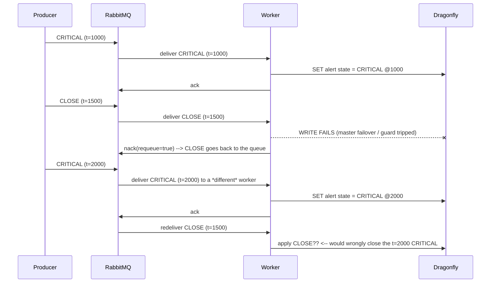

# Event Lifecycle: Severities, Ordering and Close Semantics

How an event becomes an alert, how a close retires one, and why redelivery must never make an old CLOSE retire a newer CRITICAL.

## 1. Severity levels

| Severity | Opens an alert | Closes open alerts | Notes |
|---|---|---|---|
| `FATAL` | yes | no | highest; never self-clears |
| `CRITICAL` | yes | no | |
| `WARNING` | yes | no | |
| `HARMLESS` | no | **yes** | benign termination (e.g. sensor recovered normally) |
| `CLOSE` | no | **yes** | explicit operator/system close |

Rule quoted from the spec: **a `HARMLESS` or `CLOSE` always closes the others if they exist.**

Two consequences worth stating explicitly:

- `HARMLESS` and `CLOSE` are *not* severities in the same sense as the others — they are **retirement events**. They never create alert state of their own.
- All five still get stored as events in `fw:evt:{id}` for history. Only the alert-state fold treats them differently.

## 2. The ordering requirement

Closing is inherently a comparison: "was this CLOSE after the CRITICAL it is closing?" That makes event order a correctness property, not a display detail.

The cluster must answer that question with **one total order all three workers agree on**. Two candidate clocks exist and only one is acceptable:

| Clock source | Problem |
|---|---|
| Producer clock (`ts` in the payload) | Every producer host has its own clock. Skew of a few seconds between hosts reorders events. Unfixable without PTP/NTP discipline across all producers. |
| **RabbitMQ broker clock** | A single authority per message, assigned when RabbitMQ accepts the message. All workers read the same value. |

Therefore: **ordering uses the RabbitMQ-assigned arrival timestamp, never the producer timestamp.** The producer's `ts` is retained for display and for producer-side correlation only.

## 3. Getting a broker timestamp

AMQP 0-9-1 has a `timestamp` message property, but it is **seconds** granularity and producers may set it themselves (or leave it empty). For millisecond ordering with no producer trust, have RabbitMQ stamp on arrival:

```ini
# rabbitmq.conf — required
message_interceptors.incoming.set_header_timestamp.overwrite = true
```

This sets both:

- the `timestamp` property (POSIX **seconds**), and
- the `timestamp_in_ms` header (**milliseconds**)

The default for `overwrite` is `false`, which *preserves* a producer-supplied value. **Set it to `true`**: with `false`, a producer with clock skew — or a malicious one — can forge its position in the ordering, and an old CLOSE could be made to look newer than a FATAL. Overwriting removes that entire class of problem.

This is the built-in replacement for the deprecated `rabbitmq_message_timestamp` plugin. That plugin targeted RabbitMQ ≤ 3.11 and the repository is archived; on 3.12+ use the config above. Never enable both — two interceptors on `basic.publish` break channel creation for every AMQP 0-9-1 connection.

Ordering key used by the worker:

```
broker_ts_ms = headers.timestamp_in_ms    (fallback: properties.timestamp * 1000)
```

If neither is present the message is a schema violation → `nack(requeue=false)` → DLQ.

## 4. The hazard: a redelivered CLOSE can kill a newer CRITICAL

This is the scenario the design must survive, written out precisely.



The bug is applying the CLOSE by *arrival* order instead of by *broker timestamp*. An old CLOSE redelivered late would retire a newer FATAL/CRITICAL/WARNING — silently losing an active alarm.

Note the same hazard exists without any failure at all: with **3 consumers on one quorum queue, RabbitMQ does not guarantee delivery order**. Two events published 10 ms apart can be delivered to different workers in the opposite order. Broker timestamps are what make the fold order-independent.

## 5. The fix: monotonic watermark per alert key

Every event carries a **broker timestamp**. The alert state for a given key is only advanced by an event whose timestamp is strictly newer than the last applied one.

### 5.1 Keys

| Key | Type | Contents | TTL |
|---|---|---|---|
| `fw:alert:{key}` | hash | current state + occurrence rollup + watermark | 7d (rolling) |
| `fw:alert:open:{key}` | string | `"1"` while an alert is open | 7d |
| `fw:idx:alert:open` | zset | member = alert key, score = last activity ms. The open set, so a client can be given a snapshot without `SCAN fw:alert:open:*` ([websocket-server.md](websocket-server.md) §3.1) | none (entries removed by the fold on retirement) |
| `fw:fp:{fingerprint}` | string | id of the event record that owns this content fingerprint. The content-dedup gate (§5.4.2): while present, an identical arrival is absorbed by that record instead of being stored | 7d, matching event retention |

`fw:alert:{key}` fields:

| Field | Meaning |
|---|---|
| `state` | `open` or `closed` |
| `severity` | severity of the last applied event |
| `first_seen` | broker ts of the first event in the **current open episode** |
| `last_seen` | broker ts of the **most recent** applied event — this is the "last occurrence" |
| `count` | events applied in the current episode — every applied event counts; duplicates never get here (they are dropped by the watermark, §5.4) |
| `acked_by` | operator label who acknowledged this episode, cleared on a new episode ([acknowledge.md](acknowledge.md) §6) |
| `last_id` | event id of the most recent applied event |
| `closed_by`, `closed_at` | the CLOSE/HARMLESS that retired the episode |
| `watermark`, `watermark_id` | ordering guard (§5.2) |

`{key}` is the alert identity: by default `{source}:{type}`. Two events only interact if they share a key — a CLOSE for `sensor-a:temp` never affects `sensor-b:temp`.

### 5.2 The fold, as an atomic Lua script

Three workers can process different events for the same key concurrently, so the compare-and-set must be atomic. A `WATCH`/`MULTI` dance is not needed; a single `EVAL` is:

```lua
-- KEYS[1] = fw:alert:{key}          KEYS[2] = fw:alert:open:{key}
-- KEYS[3] = fw:idx:alert:open      (optional: the open-alert index)
-- ARGV[1] = broker_ts_ms  ARGV[2] = event id  ARGV[3] = severity  ARGV[4] = dedup window ms
-- ARGV[5] = bare alert key, the index member
--
-- KEYS[3]/ARGV[5] are optional on purpose: the worker and this ConfigMap are
-- separate objects and do not roll out in lockstep, so a newer script must still
-- work when invoked with the old 2-key form.
local has_index = (KEYS[3] ~= nil) and (ARGV[5] ~= nil)
local wm_ts  = tonumber(redis.call('HGET', KEYS[1], 'watermark') or '0')
local wm_id  = redis.call('HGET', KEYS[1], 'watermark_id') or ''
local ts     = tonumber(ARGV[1])
local id     = ARGV[2]
local sev    = ARGV[3]
local window = tonumber(ARGV[4])

-- 1. ordering guard: (timestamp, id) lexicographic, see 5.3
if ts < wm_ts or (ts == wm_ts and id <= wm_id) then
  return 0                                        -- STALE
end

local is_open = redis.call('EXISTS', KEYS[2])

-- 2. retirement events
if sev == 'CLOSE' or sev == 'HARMLESS' then
  redis.call('DEL', KEYS[2])
  redis.call('HSET', KEYS[1], 'state','closed','closed_by',id,'closed_at',ts,
                              'watermark',ts,'watermark_id',id)
  redis.call('PEXPIRE', KEYS[1], 604800000)
  return 3                                        -- CLOSED
end

-- 3. occurrence rollup, see 5.4
local last  = tonumber(redis.call('HGET', KEYS[1], 'last_seen') or '0')
local count = tonumber(redis.call('HGET', KEYS[1], 'count') or '0')
local first = redis.call('HGET', KEYS[1], 'first_seen') or tostring(ts)
local fresh = 0

if is_open == 0 or last == 0 then
  count, first, fresh = 1, ts, 1                   -- new episode
elseif ts - last > window then
  count, fresh = count + 1, 1                      -- new occurrence, outside the window
end                                                -- else: coalesced, count unchanged

redis.call('SET', KEYS[2], '1', 'EX', 604800)
redis.call('HSET', KEYS[1],
  'state','open','severity',sev,'last_id',id,
  'first_seen',first,'last_seen',ts,'count',count,
  'watermark',ts,'watermark_id',id)
redis.call('PEXPIRE', KEYS[1], 604800000)
return fresh == 1 and 1 or 2                       -- 1 = new occurrence, 2 = coalesced
```

Return values — these become the `applied` field on the wire:

| Code | Meaning | UI action |
|---|---|---|
| `0` | **duplicate or stale — dropped** | change nothing |
| `1` | applied | bump `count`, set `last_seen` |
| `3` | applied, alert **closed** | remove the alert |
| ~~`2`~~ | *retired*: was "coalesced". Clients still accept it as an alias for `1` during a rolling update | treat as `1` |

Because the script is atomic, two workers racing on the same key converge on the higher `(timestamp, id)` pair regardless of which one arrives first. **That is what makes the design safe under redelivery, failover and multi-consumer reordering simultaneously.**

#### Duplicates are dropped by event id; everything else is counted

There is exactly one dedup rule: **an event is identified by its `id`**. The
worker gates on the event record with `SET fw:evt:{id} ... NX`, so the second
delivery of an id is dropped before it can touch the fold, the index, the stored
record or the live stream:

```
first delivery  -> applied=1   count 1
same id again   -> duplicate   count 1  (dropped, Last unchanged)
new id, same key-> applied=1   count 2  (Last moves)
```

Everything that gets past that gate is a distinct event, so:

- **`count` increments** — it is an event counter, and it matches what arrives.
- **`last_seen` always moves**, so *Last occurrence* is literally "when the most
  recent event arrived".
- **The duplicate is dropped entirely** — no fold, no audit copy (the first
  delivery already wrote one), no live frame. It is still ACKed: requeueing a
  message that can never succeed would loop forever.

#### Why the timestamp watermark alone was not enough

The fold's `(timestamp, id)` watermark compares against `last_seen`, which is the
**broker** arrival time. It catches a RabbitMQ redelivery, because the redelivered
message is the same message and keeps its original timestamp. It does **not**
catch a producer that re-sends an id, or two POSTs of the same id: each delivery
is a new message with a new timestamp, so the repeat always looks newer and was
counted every time. That is why a duplicate storm inflated `count` instead of
being suppressed, and why the gate had to move to the event record.

The watermark still matters for ordering — it is what stops an old `CLOSE` from
retiring a newer `CRITICAL` — but identity comes from `id`.

**Two rejected designs, and why.**

1. *Coalesce repeats inside a 5-minute window* — `count` stayed at 1 during a
   storm, indistinguishable from a broken counter.
2. *Count everything but label repeats with a `+N` badge* — once `count` counts
   every event and *Last occurrence* moves, the badge told the operator nothing
   and implied a suppression that did not exist.

Both were attempts to model "same condition still firing" from arrival times. That
question needs a source-side occurrence id, not a clock.

### 5.3 Tie-break within the same millisecond

Two events can share a millisecond, and RabbitMQ gives no ordering guarantee between them across consumers. The fold needs a deterministic winner so all workers agree, which is why the watermark is the **pair** `(broker_ts_ms, event_id)` compared lexicographically (lines 6–9 above).

Without the tie-break, a CRITICAL and a CLOSE stamped in the same millisecond could resolve differently on different workers depending on delivery order — a race that appears only under load and is nearly impossible to reproduce afterwards.

Alternative considered and rejected: random UUIDv4 ids cannot provide a meaningful tie-break *order*, but they do provide a deterministic one, which is all that is required — the requirement is convergence, not semantic priority. If a same-millisecond CRITICAL and CLOSE must resolve in favour of the CRITICAL, add an explicit severity rank as the second sort key instead of the id.

### 5.4 Two different kinds of duplicate — and they are NOT the same

Conflating these is the usual source of "why does this alert have count 4 000" and,
more recently, of "why did the board fill with 200 rows for one condition".

| | **Transport duplicate** | **Content duplicate** |
|---|---|---|
| Question | "is this the same *message* again?" | "is this the same *condition*, reported again?" |
| Cause | at-least-once delivery, worker crash before ack, replay | a producer re-reporting the same alarm with a fresh id |
| Identity | event `id` | content **fingerprint** (§5.4.2) |
| Detection | `SET fw:evt:{id} NX` | `SET fw:fp:{fingerprint} NX` |
| Result | **nothing at all happens** | the ORIGINAL record absorbs it: `count` +1, `last_seen` moves, and the new copy is **discarded** |

#### 5.4.1 Transport duplicate — same message id twice

A RabbitMQ redelivery is the same message, keeping its original id and its
original broker timestamp. It must be a no-op:

- `SET fw:evt:{id} ... NX` rejects the second write, so the record is unchanged.
- `ZADD fw:idx:src:{s}` only moves a score for a repeated member.
- The fold's `(ts, id)` watermark returns `0` for anything not newer.
- The gateway's LRU drops a repeated `PUBLISH` before it reaches a browser.

Nothing is counted and nothing is shown. This is correct: the operator already saw
the original.

#### 5.4.2 Content duplicate — same condition, different id

**This is the case that matters for the board.** An upstream alarm system
re-reports a standing condition every interval, with a new event id each time.
Counting those would mean one row per delivery, and 7-day retention turns a single
fault into hundreds of thousands of records.

Identity is therefore **content**, not id. The fingerprint
(`contentFingerprint()` in `services/worker/src/event.js`) is
`sha256(canonical(source, type, severity, payload))`, truncated to 32 hex chars.

What is excluded, and why each would break it:

| Field | Why excluded |
|---|---|
| `id` | differs on every delivery — that is the whole problem |
| `ts` | the producer's clock, also differs per delivery |
| `brokerTs` | set on arrival by the ingress, differs every time |

Object keys are sorted at every depth before hashing, so payload key order cannot
make two identical payloads look different.

The flow, and where the copy is dropped:

```text
SET fw:fp:{fingerprint} {id} NX
  -> OK    : new condition. Store the record, index it, fold it.
  -> null  : a record already owns this condition. Read the owner id, then:
               fold(brokerTs, this id)   -> count +1, last_seen moves
               and STOP. No record, no index member, no audit copy.
```

The new copy is **never written anywhere**. Its arrival is recorded only as the
rollup movement on the original record — which is exactly "the original event
stays, Last occurrence and Count move, the new event is deleted".

The fold's `count` therefore means **deliveries of this condition**, and
`last_seen` is the newest arrival. `first_seen` still marks when the episode began.

#### 5.4.3 Why there is no time window any more

An earlier design coalesced only repeats inside `FW_ALERT_DEDUP_WINDOW` (300 s).
Two things were wrong with it:

1. A storm inside the window left `count` frozen at 1 — indistinguishable from a
   broken counter, and reported as one.
2. A repeat *outside* the window created a second row for the same condition,
   which is precisely what the board must not do.

Content identity has neither problem: the same payload is always the same
condition, no matter how far apart the deliveries are. `FW_ALERT_DEDUP_WINDOW` is
retained in the environment for wire compatibility but no longer gates anything.

#### 5.4.4 What this means operationally

| Situation | Behaviour |
|---|---|
| Same payload at t and t+10s | one record; `count` 2, `last_seen` = t+10s |
| Same payload a week later | still one record, unless the fingerprint TTL expired (it is 7 days, matching retention) |
| Same payload, severity escalated WARNING → CRITICAL | **different** fingerprint → a second record. Severity is part of the identity because an escalation is a different fact about the world |
| Payload differs in one field | different fingerprint → a second record |
| `CLOSE` for a condition | different fingerprint from the severity it retires → never collapses into the occurrence it ends |

**Trade-off, stated plainly:** two genuinely distinct faults that happen to be
byte-identical within the TTL are indistinguishable and will be counted as one
condition. That is the cost of content identity, and it is the correct cost here —
an alarm system that wants them distinguished must vary the payload (an occurrence
counter, a device serial), which is what a real alarm system does anyway.

### 5.5 What is *not* guarded

The event itself is always written, always indexed, always published to `fw:ch:events`, regardless of staleness. Only the **alert state fold** is watermark-guarded. History is complete and immutable; the derived state is order-independent.

## 6. Why redelivery is safe

RabbitMQ preserves message properties and headers across requeue. A redelivered CLOSE therefore arrives with its **original** `timestamp_in_ms`, not a fresh one:

| Scenario | Redelivered CLOSE timestamp | Fold result |
|---|---|---|
| CLOSE requeued, newer CRITICAL written meanwhile | old (e.g. 1500) | watermark is 2000 → **stale, dropped** ✓ |
| CLOSE requeued, nothing newer happened | old (e.g. 1500) | watermark 1000 → **applied** ✓ |
| CLOSE requeued twice | old, twice | first applies, second is stale → **idempotent** ✓ |
| Two workers process the same CLOSE concurrently | old, both | atomic script → applied once ✓ |

**Critical operational rule:** never *republish* a message to move it, because a republish is a new publish and gets a new timestamp. Use `nack(requeue=true)` (which returns the message to the same queue with properties intact) or, when moving between queues deliberately, preserve the timestamp by copying `x-original-ts`:

```text
if republishing (DLQ -> ingest):
  set headers['x-original-ts'] = headers['timestamp_in_ms']  # MUST be preserved
worker preference order for broker_ts_ms:
  headers['x-original-ts'] > headers['timestamp_in_ms'] > properties.timestamp*1000
```

The `replay-gap` job must apply the same preference, otherwise a replay would re-stamp history with "now" and could close newer alerts.

## 7. Replay safety

The same watermark protects replay from the audit queue:

- Replaying 7 days of history re-runs every fold. Each event either advances the watermark or is dropped as stale — so the final state after a full replay is **identical** to the state before the wipe, regardless of the order records come back.
- Replay from the audit queue is therefore order-insensitive by construction. The replay job does not need to sort, batch by key, or single-thread.
- The one thing replay must not do is invent timestamps (§6).

## 8. Alert state is derived, not authoritative

| Data | Authority | Recovery |
|---|---|---|
| Events (`fw:evt:*`, `fw:idx:*`) | RabbitMQ audit queue | replay |
| Alert state (`fw:alert:*`) | the fold | recompute by replaying the window |

Alert state can be deleted at any time and rebuilt from the event history without loss. This is why no extra durability machinery is needed for it — and why retuning `FW_ALERT_DEDUP_WINDOW` is safe: replaying with a new window produces the new rollup, not a corrupted one.

## 8.1 Transport vs semantic dedup — where each lives

| Concern | Mechanism | Owner | Effect if missing |
|---|---|---|---|
| Same *message* redelivered | idempotent `SET`/`ZADD` keyed by `id` | worker (§5.4) | duplicate history rows |
| Same *message* re-published to the browser | gateway LRU on `id` | gateway ([websocket-server.md](websocket-server.md) §5) | duplicate UI rows |
| Same *message* arriving out of order | watermark fold | worker (§5.2) | an old CLOSE retires a newer CRITICAL |
| Same *condition* reporting repeatedly | occurrence window rollup | worker (§5.4) | 600k alert rows per fault, UI unusable |
| Same *condition* re-shown after a UI reconnect | backfill + client dedup on `id` | gateway + frontend | duplicated rows after every reconnect |

All five are implemented. The first two are "dedup" in the usual sense; the last two are what prevent a healthy 1 000 evt/min stream from looking like an outage.

## 9. UI implications

- The gateway forwards events as they arrive; it does not compute alert state. Rendering "this alert just closed" comes from the `severity` field of the event that closed it.
- Because the gateway can receive a stale CLOSE (it is published to `fw:ch:events` immediately, before the fold), the gateway must annotate each frame with the fold's return code:

```json
{ "op": "event", "event": { "id": "...", "severity": "CLOSE", ... }, "applied": 3 }
```

| `applied` | UI behaviour |
|---|---|
| `0` | history only — do **not** touch alert state or counts |
| `1` | new occurrence — update the alert row, increment `count`, refresh `last_seen` |
| `2` | retired — was "coalesced". Clients treat it as `1` so a gateway on the previous build cannot freeze a row mid-rollout |e an entry |
| `3` | closed — remove the alert row |

A UI that ignores `applied` will show alerts closing and immediately reopening (stale CLOSE, §4) and will show a permanently-firing alert with a count that increments 1 000 times a minute (§5.4). Both are fixed by honouring the code.

## 10. Verification

```bash
# 1. broker timestamps are present on every message
kubectl -n fire-watch exec rabbitmq-0 -- rabbitmqadmin get queue=q.event.ingest count=5 \
  | grep -E 'timestamp_in_ms|severity'

# 2. watermark guard: a stale CLOSE must not retire a newer alert
kubectl -n fire-watch exec dragonfly-0 -- redis-cli -p 6379 HGETALL fw:alert:probe:test

# 3. occurrence coalescing: publish the same CRITICAL 5x inside the 5-min window,
#    then once outside it. Expect count = 2, not 6.
kubectl -n fire-watch exec dragonfly-0 -- redis-cli -p 6379 HMGET fw:alert:probe:test count first_seen last_seen

# 4. replay invariance: wipe alert keys, replay, compare
kubectl -n fire-watch exec dragonfly-0 -- redis-cli -p 6379 --scan --pattern 'fw:alert:*'
kubectl -n fire-watch create job --from=cronjob/replay-gap replay-verify
```

Scenarios are listed in [validation.md](validation.md) §6.
