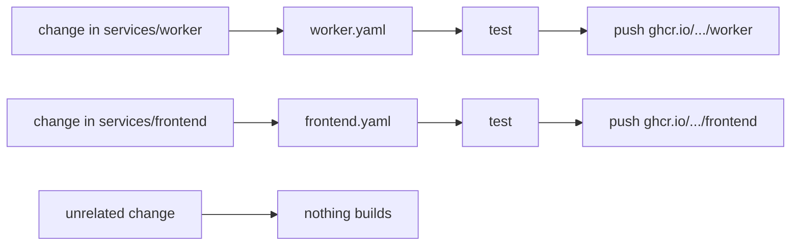
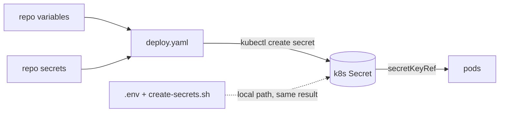

# Images

How the five service images are built and published, and how the manifests consume them. Deployment configuration is in §9.

## 1. What CI does

One workflow per service, each with a `paths` filter:

| Workflow | Builds | Triggers on changes to |
|---|---|---|
| `worker.yaml` | `worker` | `services/worker/**`, itself |
| `ws-gateway.yaml` | `ws-gateway` | `services/ws-gateway/**`, itself |
| `frontend.yaml` | `frontend` | `services/frontend/**`, itself |
| `http-ingress.yaml` | `http-ingress` | `services/http-ingress/**`, itself |
| `sentinel-bridge.yaml` | `sentinel-bridge` | `services/sentinel-bridge/**`, itself |



Why split rather than a matrix: the images share no code. A matrix rebuilt all five for a one-line frontend tweak, which is wasted runner minutes, and it moved every `latest` tag on every push even when an image was byte-identical. Splitting means a change builds and publishes exactly the thing that changed.

Test and build are steps in the **same job**, not separate jobs. With one service per workflow there is nothing to gate across services, and a `needs:` would just add a second runner start-up for no benefit. The test step still runs before the build step, so a failing test still blocks the push.

### 1.1 Path filters and tags

`paths` filters are **not evaluated for tag pushes** ([GitHub docs](https://docs.github.com/en/actions/reference/workflows-and-actions/workflow-syntax#onpushpull_requestpull_request_targetpathspaths-ignore)). That is the behaviour we want: pushing `v1.2.3` builds all five images, because a release is a release of the whole system.

### 1.2 The path-filter trap on pull requests

A workflow skipped by a path filter leaves its check in a **Pending** state, and a PR that requires that check cannot merge. With five path-filtered workflows, a required-checks rule listing all five will deadlock any PR that does not touch all five services.

Two workable policies:

| Policy | Consequence |
|---|---|
| require only `worker image / build` etc. for services a PR touches | correct, but the ruleset must be maintained per PR (not practical) |
| require **no** image checks on PRs; rely on branch protection for review | simplest, and the right default here — PR builds are feedback, not a gate |

Do **not** solve it by adding a dummy job that always runs: a matrix job with a path filter still reports skipped, and a separate always-running "path check" workflow reintroduces the all-five build you just removed.

## 2. Images and contexts

| Service | Build context | Notes |
|---|---|---|
| `worker` | `services/worker` | Node 22, multi-stage, non-root |
| `ws-gateway` | `services/ws-gateway` | Node 22 |
| `frontend` | `services/frontend` | nginx-unprivileged; **requires `dist/` to be built first** |
| `http-ingress` | `services/http-ingress` | nginx + Node, publisher confirms |
| `sentinel-bridge` | `services/sentinel-bridge` | Node 22 |

The context is the **service directory**, not the repo root. Each image needs only its own `package.json` and `src`, and a narrow context keeps the build upload small. Every service has a `.dockerignore` excluding `node_modules/` and `.env*`.

### 2.1 The frontend exception

`dist/` is git-ignored, so it never exists on a fresh checkout — the Dockerfile's `COPY dist/` would fail. The frontend workflow therefore builds it inside the run:

```yaml
- run: npm run build
- run: test -f dist/index.html || { echo "dist/index.html missing"; exit 1; }
```

The explicit `test -f` is deliberate: if the build ever changes its output directory, the failure should name the missing file rather than surfacing as a confusing `COPY failed` from BuildKit.

It is done in the workflow rather than the Dockerfile to keep the shipped image nginx-only — no Node toolchain in a runtime that serves static files.

## 3. Tags

| Trigger | Tags produced |
|---|---|
| push to `main` (matching paths) | `main`, `sha-<short>`, and **`latest`** |
| pull request (matching paths) | `pr-<n>`, `sha-<short>` — **never `latest`**, and nothing is pushed |
| tag `v1.2.3` | `1.2.3`, `1.2`, `sha-<short>`, `latest` — for **all five** services |
| manual dispatch | same as a branch push for the selected ref |

`latest` only moves on a default-branch push. A PR builds the image to prove it compiles but has no credential to push with (`docker/login-action` is skipped on `pull_request`), because `pull_request_target` would hand a write token and repository secrets to unreviewed code.

Each workflow has its own concurrency group (`image-<service>-<ref>`). A shared group would make the worker build cancel the frontend build when both are pushed in the same commit.

## 4. Registry path

```text
ghcr.io/cucumberone/fire-watch/<service>:<tag>
```

`IMAGE_NAMESPACE`/`IMAGE` is hard-coded rather than `${{ github.repository }}` because OCI registry paths must be lowercase and the repository casing is `cucumberone/fire-watch`. If the repo is renamed, the `IMAGE` env var in each of the five workflows and the `images:` block in the GHCR overlay are the places to change.

## 5. Permissions and authentication

The workflow uses `secrets.GITHUB_TOKEN` — no PAT, no repository secrets to configure for pushing:

```yaml
permissions:
  contents: read
  packages: write
```

`docker/metadata-action` sets `org.opencontainers.image.source` to the repository URL. That label is what links the published package to the repository, which is what grants the workflow automatic access to its own packages.

**The packages are private by default.** That affects pulling:

| Cluster | What is needed |
|---|---|
| OpenShift (can reach the internal registry) | nothing — the base manifests never reference GHCR |
| Anything using the GHCR overlay | a pull secret `ghcr-pull` in the namespace |
| Public package | change visibility in the package settings; the pull secret then becomes unnecessary |

Create the pull secret out of band:

```bash
kubectl -n fire-watch create secret docker-registry ghcr-pull \
  --docker-server=ghcr.io \
  --docker-username=<github-user> \
  --docker-password=<PAT with read:packages>
```

## 6. Using the images

The base points at the OpenShift internal registry, so a normal `kubectl apply -k k8s/base` is unaffected by CI. To deploy the CI-built images instead:

```bash
kubectl apply -k k8s/overlays/ghcr
```

That overlay rewrites all five image references and attaches `imagePullSecrets: [{name: ghcr-pull}]` to the five Deployments. RabbitMQ, Dragonfly and Redis are pulled from `docker.io` and need no credential, so they are not patched.

Verified: `kubectl kustomize k8s/overlays/ghcr` renders 5 `ghcr.io` image references and 5 `imagePullSecrets`, and the base plus both lab overlays still render unchanged.

## 7. Pinning for production

The overlay uses `latest` for convenience. That is fine for a lab and wrong for production: a pod restarted after a new push silently changes version.

Pin per environment by editing the overlay's `newTag`, preferring the `sha-<short>` tag each CI run prints, or the digest:

```yaml
images:
  - name: .../worker
    newName: ghcr.io/cucumberone/fire-watch/worker
    newTag: sha-9f3c1ab          # or: digest: sha256:...
```

The base manifests already carry the same warning: production requires digests, not tags.

## 8. Deliberate omissions

| Omitted | Why |
|---|---|
| a single matrix workflow | rebuilds all five for a one-service change and moves every `latest` tag needlessly; see §1 |
| `pull_request_target` | runs with secrets on unreviewed code; a PR editing a Dockerfile would get the registry credential |
| a "run on everything" job for required checks | reintroduces the all-five build. See §1.2 — use branch protection instead of required image checks on PRs |
| `arm64` | the target is x86 OpenShift; a second platform doubles build time for an image nothing runs. Add it in the `platforms:` field when there is an arm64 cluster |
| Trivy / SCA scan | worth adding, but it needs a policy decision on what fails a build. Not invented here |
| Auto-commit of new digests back to the overlay | turns every build into a commit and a rebuild loop; pin by hand per environment |
| `npm test` inside the image build | tests run before the build step in the same workflow, so the image build stays a packaging step |

`provenance: true` and `sbom: true` are enabled on the image builds, so each pushed image carries an SBOM and a signed provenance attestation at no extra configuration cost.

## 9. Deployment configuration

Deployment configuration lives in **two GitHub Environments**, `lab` and `prod`. Which store owns a value is decided by whether it is a credential.

### 9.0 Two environments, one workflow

`.github/workflows/deploy.yaml` takes an `environment` input (`lab` or `prod`) and binds the run to that Environment. GitHub resolves `vars.X` and `secrets.X` against the job's Environment before the repository defaults, so one workflow deploys to either target with no branching.

| | `lab` | `prod` |
|---|---|---|
| `NAMESPACE` | `fire-watch-lab` | `fire-watch` |
| Overlay | `k8s/overlays/lab/openshift` or `…/kubernetes` | `k8s/base` or `k8s/overlays/ghcr` |
| Reviewers | none | **add required reviewers** |
| `KUBECONFIG_B64` | lab cluster | prod cluster |

**The `NAMESPACE` variable must match the namespace the chosen overlay hard-codes.** The overlays set their own `namespace:` — `k8s/overlays/lab/*` says `fire-watch-lab`, `k8s/base` and `k8s/overlays/ghcr` say `fire-watch`. If the variable disagrees, the Secrets land in one namespace and the workloads in another, and every pod then fails to resolve its `secretKeyRef`.

The workflow refuses to run when they disagree (`Reconcile overlay namespace with $NAMESPACE`), printing both values. That check exists because the failure it prevents surfaces on the pod, far from the actual mistake.

Why two environments rather than two workflows: the deploy logic is identical and only the values differ. Two workflows would be two places to fix the same bug, and the day only one is patched the environments silently diverge.

### 9.1 Which store owns what

Set per environment at **Settings → Environments → <lab|prod>**.

| GitHub store | Values | Why there |
|---|---|---|
| **Variables** (plaintext) | `NAMESPACE`, `AMQP_HOST`, `AMQP_PORT`, `DFLY_MASTER_NAME`, `AMQP_USER` | not credentials. Readable by anyone with repo read access, and printed unmasked in logs — which is fine for a hostname and a namespace |
| **Secrets** (masked) | `AMQP_PASS`, `DRAGONFLY_PASSWORD`, `FW_INGEST_TOKEN`, `KUBECONFIG_B64` | credentials. Masked in logs and not readable back through the API |

`AMQP_USER` is a variable rather than a secret: it is an account name, not a credential, and a GitHub secret cannot be read back after saving, which makes it painful to verify. It is worthless without `AMQP_PASS`, which is a secret.

`AMQP_PASS` is deliberately its own value per environment. Sharing a broker password between lab and prod means a lab mistake can authenticate against production.

An environment-scoped value overrides the repository default of the same name, so a repo-level `NAMESPACE` will NOT be used once the job binds to an Environment — each environment needs its own copy.

`KUBECONFIG_B64` is the base64 of a kubeconfig. Base64 so a multi-line YAML file survives the secret field intact; the workflow decodes it to a `0600` file outside the workspace so it is never picked up by a later `git add` or uploaded as an artifact.

Set them at **Settings → Secrets and variables → Actions**.

### 9.2 The chain: store → Secret → pod



Pods never see GitHub and never see `.env`. They read a Kubernetes Secret injected as an env var by `secretKeyRef`, in eight manifests: RabbitMQ, Dragonfly, the three Sentinels, sentinel-bridge, redis-exporter, http-ingress, workers and ws-gateway.

`.env` and the GitHub store are two **ways to create the same Secret**, not two layers. Use whichever is convenient; both produce identical objects.

### 9.3 Why deploy is manual only

`workflow_dispatch`, not a push trigger. Deploying on every push to `main` would make an image tag and a cluster mutation the same event, so a docs-only merge would re-apply the cluster. For CD later, add a `push: tags: ['v*.*.*']` trigger that hard-codes `environment: prod`, plus required reviewers — never a branch trigger.

`dry_run` defaults to **true**. A mistaken click renders and server-side-validates without mutating anything; the operator has to consciously untick it.

The `environment` input has **no default**. A deploy should not land in production because a form was submitted without being read.

Concurrency is `deploy-fire-watch-<environment>` with `cancel-in-progress: false`: separate groups so a lab deploy never blocks prod, and never cancelling because two interleaved applies would leave a cluster between two desired states.

### 9.4 Reachability

A GitHub-hosted runner is on the public internet and **cannot reach a cluster on a private LAN** — a MicroK8s node at `192.168.50.x` is unreachable. Options in order of preference:

| Option | Note |
|---|---|
| self-hosted runner inside the network | `runs-on: [self-hosted, ...]`; the correct answer for a homelab or on-prem cluster |
| publicly reachable API server | needs an IP allow-list; not recommended |
| run locally | `./scripts/create-secrets.sh && kubectl apply -k ...` — what works today |

The workflow is written for the first or second case. Nothing about it is wrong for a homelab; it simply will not work until the runner or the API server is reachable.

### 9.5 Ordering and failure behaviour

| Step | Reason |
|---|---|
| validate config first | an empty `DRAGONFLY_PASSWORD` would create a Secret with an empty key, and every Sentinel would report the master as down — a failure far from its cause. Only variable *names* are printed, never values |
| reconcile the overlay namespace | the overlays hard-code `namespace:`; a mismatch with `$NAMESPACE` puts Secrets and workloads in different namespaces (§9.0) |
| Secrets before workloads | on a first install Dragonfly needs `--requirepass` at start, and the Sentinels bake the password into `sentinel.conf` on first boot |
| `--from-env-file`, not `--from-literal` | a literal puts the value in the process argument list, where it can surface in an error message |
| namespace must pre-exist | `k8s/base` deliberately does not own the namespace (it is shared), so creating it here would be the workflow making a policy decision it has no business making |
| rollout waits only on Deployments | RabbitMQ and Dragonfly are StatefulSets with slow readiness; waiting on them would make a deploy look hung during a normal single-node reboot |
| `Summary` runs `always()` | a failed deploy is exactly when you want the step summary, so it cannot be gated on success |

### 9.6 First-time setup per environment

```bash
# 1. Namespace (the manifests do not own it)
kubectl create namespace fire-watch-lab        # for lab
kubectl create namespace fire-watch           # for prod

# 2. Generate the values
openssl rand -base64 48 | tr -dc 'A-Za-z0-9' | cut -c1-32   # DRAGONFLY_PASSWORD, AMQP_PASS
openssl rand -hex 32                                        # FW_INGEST_TOKEN

# 3. Kubeconfig for the environment's cluster
base64 -w0 < ~/.kube/config     # Linux      -> KUBECONFIG_B64
base64 -i ~/.kube/config        # macOS
```

Then in **Settings → Environments → lab** (and again for `prod`): add the five variables and four secrets from §9.1, and set `NAMESPACE` to `fire-watch-lab` for lab / `fire-watch` for prod. On `prod`, add required reviewers.
