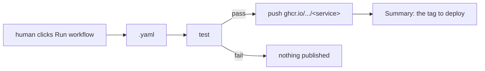
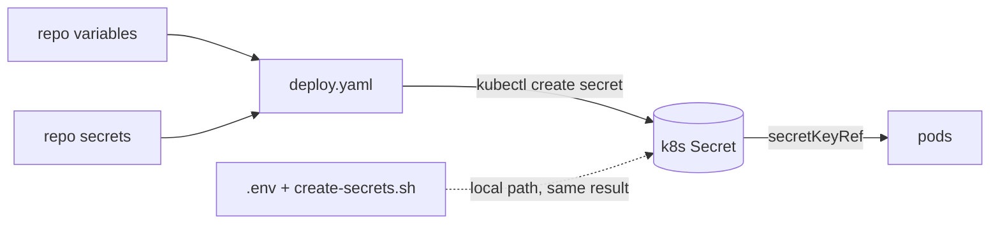

# Images

How the five service images are built and published, and how the manifests consume them. Deployment configuration is in §9.

## 1. What CI does

**Every workflow is manual — `workflow_dispatch` only.** No `push`, no
`pull_request`. Nothing publishes as a side effect of a merge; an image moves only
when a human asks for it.

| Workflow | Builds | Trigger |
|---|---|---|
| `worker.yaml` | `worker` | manual |
| `ws-gateway.yaml` | `ws-gateway` | manual |
| `frontend.yaml` | `frontend` | manual |
| `http-ingress.yaml` | `http-ingress` | manual |
| `sentinel-bridge.yaml` | `sentinel-bridge` | manual |
| `deploy.yaml` | — | manual |

Every one of them takes an **`environment` input** (`lab` or `prod`) and binds the
job to it with `environment: ${{ inputs.environment }}`. That is what makes
`vars.*` and `secrets.*` resolve against the chosen Environment instead of the
repository defaults — one workflow, either target, no branching (§1.2).



One workflow per service so a build touches exactly one image. Test and build are
steps in the **same job** — with one service per workflow there is nothing to gate
across services, and a `needs:` would just add a second runner start-up. The test
step still runs before the build step, so a failing test still blocks the push.

### 1.1 Tags

Manual dispatch has no branch, PR or tag ref, so the tags cannot come from the
event:

| Tag | Always? | Purpose |
|---|---|---|
| `sha-<short>` | yes | the commit the image was built from |
| `manual-<yyyyMMdd-HHmmss>` | yes | distinguishes two runs of the same commit |
| `latest` | **opt-in** (`push_latest` input, default `true`) | the "current good build" claim |

`latest` is opt-in rather than automatic because it is a promise that this build
is the one to run, and a manual run is not automatically that. The other two tags
are always produced, so every run stays addressable regardless.

**This replaced a silently broken configuration.** The previous version used
`type=ref,event=branch`, `type=ref,event=pr`, `type=semver`, plus
`flavor: latest=auto`. Under `workflow_dispatch` those produce nothing:
`latest=auto` only fires for tag/semver/pep440/match events, so leaving them in
would have produced images tagged **only** with a sha and never `latest` — while
the workflow still read as though it did.

### 1.2 The environment input, and what it changes

All six workflows ask which environment to target. For `deploy.yaml` that is
load-bearing: it selects the namespace, kubeconfig, and broker/Dragonfly
credentials (§9).

For the five image workflows it changes **nothing about the image path**. The
image is hard-coded:

```yaml
env:
  IMAGE: ghcr.io/cucumberone/fire-watch/worker
```

Why hard-coded rather than `${{ github.repository }}`: OCI registry paths must be
lowercase and the repository casing is `cucumberone/fire-watch`, so the context
value cannot be used directly.

Why hard-coded rather than a per-environment variable: it must equal `newName:`
in `k8s/overlays/ghcr`. A variable could point the build somewhere the overlay
does not pull from, which fails as `ImagePullBackOff` on every pod while the
build reports success — the failure appears in the cluster, not in CI, and
nothing points at the variable. One literal in two places (workflow and overlay)
is easier to keep honest than an unused override that can silently disagree.

**So what does the environment selection do for a build?** It binds the job to
that environment, which resolves `vars.*` and `secrets.*` against it. Today the
image workflows read neither, so choosing `lab` vs `prod` produces the same
image. The binding is there for consistency with `deploy.yaml` and so
environment-scoped configuration *can* be added later without another edit to
five files. If that reads as pointless today: it is — deliberately, rather than
a variable that looks useful and breaks deploys.

**Prerequisite:** the Environments must exist in **Settings → Environments**
before the first run. If you pick a name that does not exist yet, GitHub creates
it with no protection.

### 1.3 Why no push trigger

Deploying or publishing on every push makes an image tag and a cluster mutation
the same event. A merge that only fixes a typo in the docs would rebuild and
re-tag images nobody changed. Manual dispatch keeps that decision explicit.

The cost is that a stale image is possible if someone forgets to run the build.
The mitigation is that `deploy.yaml` is manual too, and the image tag it deploys
is printed in the step summary — so what is running is always a tag a human chose.

## 2. Images and contexts

| Service | Build context | Notes |
|---|---|---|
| `worker` | `services/worker` | Node 22, multi-stage, non-root |
| `ws-gateway` | `services/ws-gateway` | Node 22 |
| `frontend` | `services/frontend` | nginx-unprivileged; **requires `dist/` to be built first** |
| `http-ingress` | **repo root (`.`)** | needs `schemas/`, which is outside the service directory — see §2.1 |
| `sentinel-bridge` | `services/sentinel-bridge` | Node 22 |

With one exception (below), the context is the **service directory**, not the repo
root. A narrow context keeps the build upload small. Every service has a
`.dockerignore` excluding `node_modules/` and `.env*`.

### 2.1 The http-ingress exception: it needs a sibling directory

`http-ingress` reads `schemas/event-ingest.schema.json` **at runtime**
([event-schema.md](event-schema.md) §5.1), so `schemas/` has to be inside the
image. A build cannot copy from outside its own context, so this is the one image
built from the repo root:

```yaml
context: .
file: services/http-ingress/Dockerfile
```

Its Dockerfile paths are therefore root-relative, and the schema uses an
**absolute** destination because the code resolves `/schemas/…` and not
`/app/schemas/…`:

```dockerfile
COPY services/http-ingress/src ./src
COPY schemas /schemas
```

A root `.dockerignore` exists only to keep this context small; it is not used by
the other builds.

The failure mode when either path is wrong is deceptive: the pod starts, passes
its probes, and then rejects every `EVT_*` request with
`400 invalid_event: ENOENT … /schemas/event-ingest.schema.json` — which reads as a
bad payload rather than a packaging bug. The ingress now validates the schema
before it starts listening and exits non-zero, so the mistake surfaces as a crash
loop instead.

### 2.2 The frontend exception

`dist/` is git-ignored, so it never exists on a fresh checkout — the Dockerfile's `COPY dist/` would fail. The frontend workflow therefore builds it inside the run:

```yaml
- run: npm run build
- run: test -f dist/index.html || { echo "dist/index.html missing"; exit 1; }
```

The explicit `test -f` is deliberate: if the build ever changes its output directory, the failure should name the missing file rather than surfacing as a confusing `COPY failed` from BuildKit.

It is done in the workflow rather than the Dockerfile to keep the shipped image nginx-only — no Node toolchain in a runtime that serves static files.

## 3. Concurrency

Each workflow has its own group (`image-<service>-<ref>`) with
`cancel-in-progress: true`. A shared group would make the worker build cancel the
frontend build. `deploy.yaml` uses `deploy-fire-watch-<environment>` with
`cancel-in-progress: false`, because two interleaved applies would leave a cluster
between two desired states.

## 4. Registry path

```text
ghcr.io/cucumberone/fire-watch/<service>:<tag>
```

`IMAGE` is hard-coded rather than `${{ github.repository }}` because OCI registry paths must be lowercase and the repository casing is `cucumberone/fire-watch`. If the repo or org is renamed, the `IMAGE` env var in each of the five workflows **and** the `newName:` entries in the GHCR overlay are the places to change — they must stay identical.

## 5. Permissions and authentication

The workflow uses `secrets.GITHUB_TOKEN` — no PAT, no repository secrets to configure for pushing:

```yaml
permissions:
  contents: read
  packages: write
```

`docker/metadata-action` sets `org.opencontainers.image.source` to the repository URL. That label is what links the published package to the repository, which is what grants the workflow automatic access to its own packages.

**The packages are private by default.** That affects pulling:

| Cluster | What is needed |
|---|---|
| OpenShift (can reach the internal registry) | nothing — the base manifests never reference GHCR |
| Anything using the GHCR overlay | a pull secret `ghcr-pull` in the namespace |
| Public package | change visibility in the package settings; the pull secret then becomes unnecessary |

Create the pull secret out of band:

```bash
kubectl -n fire-watch create secret docker-registry ghcr-pull \
  --docker-server=ghcr.io \
  --docker-username=<github-user> \
  --docker-password=<PAT with read:packages>
```

## 6. Using the images

The base points at the OpenShift internal registry, so a normal `kubectl apply -k k8s/base` is unaffected by CI. To deploy the CI-built images instead:

```bash
kubectl apply -k k8s/overlays/ghcr
```

That overlay rewrites all five image references. RabbitMQ, Dragonfly and Redis are pulled from `docker.io` and need no credential, so they are not patched.

Verified: `kubectl kustomize k8s/overlays/ghcr` renders 5 `ghcr.io` image references, and the base plus both lab overlays still render unchanged.

## 7. Pinning for production

The overlay uses `latest` for convenience. That is fine for a lab and wrong for production: anything that moves `latest` silently changes what a restarted pod runs.

Pin per environment by editing the overlay's `newTag`, preferring the `sha-<short>` tag (or the `manual-<timestamp>` tag) that each build prints in its step summary, or the digest:

```yaml
images:
  - name: .../worker
    newName: ghcr.io/cucumberone/fire-watch/worker
    newTag: sha-9f3c1ab          # or: digest: sha256:...
```

The base manifests already carry the same warning: production requires digests, not tags.

### 7.1 `imagePullPolicy: Always` is required on a mutable tag

All five GHCR Deployments set `imagePullPolicy: Always`. This is not tuning, it is
correctness: with `IfNotPresent` and a mutable tag the kubelet keeps whatever image
the node already cached, so **a rebuild never deploys**. Observed on the lab
cluster — `sentinel-bridge` ran `sha256:1b8b9436…` for ten minutes while GHCR held
`sha256:4710ad48…`, and nothing in the pod reported the mismatch. Two restarts
were needed before the fix took effect, which is exactly the kind of silent drift
that makes an operator distrust a deploy.

Trade-off: `Always` needs the registry reachable on every container start. Once
production pins an immutable tag or digest (§7), `IfNotPresent` becomes correct
again, because the tag then *is* the identity. Until then, `Always`.

## 7.2 Weekly purge of old versions

`.github/workflows/purge-image-versions.yaml` deletes old GHCR versions every
Monday at 03:17 UTC, keeping **only the version currently tagged `latest`** for
each of the five services.

Run it manually with `dry_run` (the default) to see what it would remove.

### It contradicts §7, and that has to be a choice

§7 tells production to pin a Deployment to `sha-<short>` or a digest. This workflow
**deletes those tags**. A production deployment pinned to a sha tag will break on
the next purge — and because every Deployment sets `imagePullPolicy: Always`
(§7.1), the pod cannot fall back to a cached layer: it goes into
`ImagePullBackOff`, and GHCR has no undelete.

So this is only coherent while everything deploys `latest`. Before production pins
anything, either:

- stop running the purge, or
- run it with `keep_referenced: true`, which reads the Deployments in the namespace
  and keeps every tag they reference.

`keep_referenced` needs cluster access the workflow does not have today, so it is
off by default and fails loudly if kubectl is unavailable rather than silently
purging more than intended.

### Guards

Deletion is irreversible and a `latest` tag is **opt-in** per build, so a naive
"not tagged latest" rule would empty a package whose builds never pushed `latest`.
Four checks prevent that:

| Guard | Why |
|---|---|
| no version tagged `latest` → skip the package **and fail the job** | otherwise every version matches "not latest" and the package is emptied |
| a package with one version is left alone | nothing to gain, everything to lose |
| `dry_run` defaults to **true** on manual dispatch | the destructive path is an explicit choice; a *scheduled* run uses `false`, or it would do nothing forever |
| a failed delete fails the job | a weekly job that half-works and reports success is how growth goes unnoticed until the storage quota |

Two implementation details worth keeping: the delete loop reads from a here-doc
rather than a pipe (a piped loop runs in a subshell and `fail=1` inside it is
discarded), and the package name is URL-encoded in the API path (`fire-watch%2Fworker`)
because an unencoded slash 404s and reads as "package does not exist".

## 8. Deliberate omissions

| Omitted | Why |
|---|---|
| any `push` / `pull_request` trigger | makes publishing a side effect of a merge; see §1.2 |
| a single matrix workflow | one build would touch all five images for a one-service change; see §1 |
| `pull_request_target` | runs with secrets on unreviewed code. Not reachable here, but the rule stands if a PR trigger is ever added |
| `flavor: latest=auto` | produces no `latest` under `workflow_dispatch`; `latest` is an explicit `type=raw` input instead, see §1.1 |
| `arm64` | the target is x86 OpenShift; a second platform doubles build time for an image nothing runs. Add it in the `platforms:` field when there is an arm64 cluster |
| Trivy / SCA scan | worth adding, but it needs a policy decision on what fails a build. Not invented here |
| Auto-commit of new digests back to the overlay | turns every build into a commit and a rebuild loop; pin by hand per environment |
| `npm test` inside the image build | tests run before the build step in the same workflow, so the image build stays a packaging step |

`provenance: true` and `sbom: true` are enabled on the image builds, so each pushed image carries an SBOM and a signed provenance attestation at no extra configuration cost.

## 9. Deployment configuration

Deployment configuration lives in **two GitHub Environments**, `lab` and `prod`. Which store owns a value is decided by whether it is a credential.

### 9.0 Two environments, one workflow

`.github/workflows/deploy.yaml` takes an `environment` input (`lab` or `prod`) and binds the run to that Environment. GitHub resolves `vars.X` and `secrets.X` against the job's Environment before the repository defaults, so one workflow deploys to either target with no branching.

| | `lab` | `prod` |
|---|---|---|
| `NAMESPACE` | `fire-watch-lab` | `fire-watch` |
| Overlay | `k8s/overlays/lab/openshift` or `…/kubernetes` | `k8s/base` or `k8s/overlays/ghcr` |
| Reviewers | none | **add required reviewers** |
| `KUBECONFIG_B64` | lab cluster | prod cluster |

**The `NAMESPACE` variable must match the namespace the chosen overlay hard-codes.** The overlays set their own `namespace:` — `k8s/overlays/lab/*` says `fire-watch-lab`, `k8s/base` and `k8s/overlays/ghcr` say `fire-watch`. If the variable disagrees, the Secrets land in one namespace and the workloads in another, and every pod then fails to resolve its `secretKeyRef`.

The workflow refuses to run when they disagree (`Reconcile overlay namespace with $NAMESPACE`), printing both values. That check exists because the failure it prevents surfaces on the pod, far from the actual mistake.

Why two environments rather than two workflows: the deploy logic is identical and only the values differ. Two workflows would be two places to fix the same bug, and the day only one is patched the environments silently diverge.

### 9.1 Which store owns what

Set per environment at **Settings → Environments → <lab|prod>**.

| GitHub store | Values | Why there |
|---|---|---|
| **Variables** (plaintext) | `NAMESPACE`, `AMQP_HOST`, `AMQP_PORT`, `DFLY_MASTER_NAME`, `AMQP_USER` | not credentials. Readable by anyone with repo read access, and printed unmasked in logs — which is fine for a hostname and a namespace |
| **Secrets** (masked) | `AMQP_PASS`, `DRAGONFLY_PASSWORD`, `FW_INGEST_TOKEN`, `KUBECONFIG_B64` | credentials. Masked in logs and not readable back through the API |

`AMQP_USER` is a variable rather than a secret: it is an account name, not a credential, and a GitHub secret cannot be read back after saving, which makes it painful to verify. It is worthless without `AMQP_PASS`, which is a secret.

`AMQP_PASS` is deliberately its own value per environment. Sharing a broker password between lab and prod means a lab mistake can authenticate against production.

An environment-scoped value overrides the repository default of the same name, so a repo-level `NAMESPACE` will NOT be used once the job binds to an Environment — each environment needs its own copy.

`KUBECONFIG_B64` is the base64 of a kubeconfig. Base64 so a multi-line YAML file survives the secret field intact; the workflow decodes it to a `0600` file outside the workspace so it is never picked up by a later `git add` or uploaded as an artifact.

Set them at **Settings → Secrets and variables → Actions**.

### 9.2 The chain: store → Secret → pod



Pods never see GitHub and never see `.env`. They read a Kubernetes Secret injected as an env var by `secretKeyRef`, in eight manifests: RabbitMQ, Dragonfly, the three Sentinels, sentinel-bridge, redis-exporter, http-ingress, workers and ws-gateway.

`.env` and the GitHub store are two **ways to create the same Secret**, not two layers. Use whichever is convenient; both produce identical objects.

### 9.3 Why deploy is manual only

`workflow_dispatch`, not a push trigger. Deploying on every push to `main` would make an image tag and a cluster mutation the same event, so a docs-only merge would re-apply the cluster. For CD later, add a `push: tags: ['v*.*.*']` trigger that hard-codes `environment: prod`, plus required reviewers — never a branch trigger.

`dry_run` defaults to **true**. A mistaken click renders and server-side-validates without mutating anything; the operator has to consciously untick it.

The `environment` input has **no default**. A deploy should not land in production because a form was submitted without being read.

Concurrency is `deploy-fire-watch-<environment>` with `cancel-in-progress: false`: separate groups so a lab deploy never blocks prod, and never cancelling because two interleaved applies would leave a cluster between two desired states.

### 9.4 Reachability

A GitHub-hosted runner is on the public internet and **cannot reach a cluster on a private LAN** — a MicroK8s node at `192.168.50.x` is unreachable. Options in order of preference:

| Option | Note |
|---|---|
| self-hosted runner inside the network | `runs-on: [self-hosted, ...]`; the correct answer for a homelab or on-prem cluster |
| publicly reachable API server | needs an IP allow-list; not recommended |
| run locally | `./scripts/create-secrets.sh && kubectl apply -k ...` — what works today |

The workflow is written for the first or second case. Nothing about it is wrong for a homelab; it simply will not work until the runner or the API server is reachable.

### 9.5 Ordering and failure behaviour

| Step | Reason |
|---|---|
| validate config first | an empty `DRAGONFLY_PASSWORD` would create a Secret with an empty key, and every Sentinel would report the master as down — a failure far from its cause. Only variable *names* are printed, never values |
| reconcile the overlay namespace | the overlays hard-code `namespace:`; a mismatch with `$NAMESPACE` puts Secrets and workloads in different namespaces (§9.0) |
| Secrets before workloads | on a first install Dragonfly needs `--requirepass` at start, and the Sentinels bake the password into `sentinel.conf` on first boot |
| `--from-env-file`, not `--from-literal` | a literal puts the value in the process argument list, where it can surface in an error message |
| namespace must pre-exist | `k8s/base` deliberately does not own the namespace (it is shared), so creating it here would be the workflow making a policy decision it has no business making |
| rollout waits only on Deployments | RabbitMQ and Dragonfly are StatefulSets with slow readiness; waiting on them would make a deploy look hung during a normal single-node reboot |
| `Summary` runs `always()` | a failed deploy is exactly when you want the step summary, so it cannot be gated on success |

### 9.6 First-time setup per environment

```bash
# 1. Namespace (the manifests do not own it)
kubectl create namespace fire-watch-lab        # for lab
kubectl create namespace fire-watch           # for prod

# 2. Generate the values
openssl rand -base64 48 | tr -dc 'A-Za-z0-9' | cut -c1-32   # DRAGONFLY_PASSWORD, AMQP_PASS
openssl rand -hex 32                                        # FW_INGEST_TOKEN

# 3. Kubeconfig for the environment's cluster
base64 -w0 < ~/.kube/config     # Linux      -> KUBECONFIG_B64
base64 -i ~/.kube/config        # macOS
```

Then in **Settings → Environments → lab** (and again for `prod`): add the five variables and four secrets from §9.1, and set `NAMESPACE` to `fire-watch-lab` for lab / `fire-watch` for prod. On `prod`, add required reviewers.
