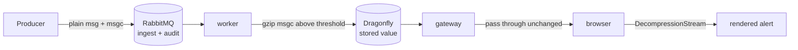

# Payload Fields: `msg` and `msgc`, Compression

Two plain-text payload fields, what each means, and whether they can be compressed at the worker and decompressed in the browser.

## 1. The two fields

| Field | Meaning | Typical size | Mutability |
|---|---|---|---|
| `msg` | the short / current message text — a summary, a single line | ~64–256 B | changes on every occurrence |
| `msgc` | the **c**omplete string — the full body, e.g. a stack trace, a multi-line log excerpt, a device-reported detail block | ~1–8 KiB, sometimes much more | usually the same for every occurrence of a condition |

> **Naming:** these are wire names. The web UI labels them **Summary** and **MsgCompleteString**; the rename happens once at the frontend boundary and does not affect the wire, Dragonfly keys or the audit WAL ([frontend.md](frontend.md) §4.1).

`msgc` is the long one. At 2 048 B minimum event size that is already the baseline, and it is the field that dominates memory, network and browser rendering cost.

## 2. Can they be compressed? Yes — but not both the same way

**Short answer:** compressing is safe, but `msg` and `msgc` have opposite economics, and compressing `msg` is usually a net *loss*.

| | `msg` | `msgc` |
|---|---|---|
| Realistic size | 64–256 B | 1 000–8 000 B |
| gzip ratio on short ASCII text | ~0.9–1.1x (gz header alone is ~18 B) | **3–10x** |
| Compress at worker? | **no benefit, often negative** | **yes, clear win** |
| Decompress in browser? | n/a | yes, cheap |

### 2.1 Why `msg` should stay plain

gzip has ~18 bytes of framing overhead (header + trailer) before any savings. On a 100-byte summary that is a 20% tax to save maybe 10 bytes. Brotli/gzip on very short strings routinely **grows** the payload.

Rule: apply compression only when the field exceeds a threshold, `FW_COMPRESS_MIN` (default **1 024 B**). Below that, store plain. This single rule captures ~all of the benefit and none of the cost.

### 2.2 Why `msgc` is the win

`msgc` is the field that breaks the sizing model. From [sizing.md](sizing.md) §2.1, the working set scales linearly with total event bytes:

| `msgc` stored | Working set / pod | Aggregate |
|---|---|---|
| 2 KiB plain | ≈ 24.5 GiB | ≈ 73.5 GiB |
| 2 KiB → ~600 B gzip | ≈ 8.5 GiB | ≈ 25 GiB |
| 8 KiB plain | ≈ 92 GiB | ≈ 276 GiB |
| 8 KiB → ~1.4 KiB gzip | ≈ 22 GiB | ≈ 66 GiB |

So compressing `msgc` is a **~3x reduction in RAM, PV and snapshot size**, and it is the single cheapest lever in the whole design. (The alternative lever is a shorter TTL, which costs history.)

### 2.3 Is it *safe*? The four real risks

| Risk | Verdict |
|---|---|
| Loss of exact bytes | **No** — gzip is lossless. The original string is recovered byte-for-byte. |
| Data loss if Dragonfly is rebuilt | **No** — the audit queue stores the *original* message, so the replay path does not depend on the compression scheme (§4). |
| Decompression failure in the browser | Handled explicitly — a corrupt/unknown blob must degrade to a visible marker, never to a blank alert (§5). |
| Searchability | **Yes, genuinely lost** — see §6. This is the real trade-off. |

## 3. Where compression happens



| Layer | Responsibility |
|---|---|
| Producer | sends **plain** text. Never compresses. |
| RabbitMQ | stores **plain** — the queue is the WAL and must be readable/replayable without app code ([persistence-and-durability.md](persistence-and-durability.md) §4). |
| Worker | compresses on write when the field exceeds `FW_COMPRESS_MIN`; **never modifies the audit copy** |
| Dragonfly | stores the compressed bytes as the value |
| Gateway | does **not** decompress — it has no write access and no reason to pay the CPU; it forwards bytes |
| Browser | decompresses with the native `DecompressionStream` API |

Compressing at the worker is the right place: it is the only component that already touches every byte on the write path, and doing it there keeps the audit/WAL copy plain (§3.1).

### 3.1 The audit copy stays uncompressed — deliberately

The audit queue is the recovery source of truth. If it stored compressed blobs:

- a replay would depend on the compression format being stable across releases;
- an operator inspecting the queue with `rabbitmqadmin get` would see binary junk;
- a future component (export, SIEM feed) would need the same codec.

Storage cost of keeping it plain: ≈19.3 GiB for 7 days ([sizing.md](sizing.md) §3.6). Compression would save maybe 13 GiB of that. Not worth coupling the WAL to an application codec.

## 4. On-disk format

The value must be self-describing, because a rolling upgrade can mix compressed and plain rows in the same keyspace.

```text
fw:evt:{id}  value (RESP bulk string):

  plain:       <original UTF-8 bytes>                      (first byte is '{' for JSON)
  compressed:  \x1f\x8b <gzip stream>                      (first byte 0x1f, second 0x8b)
```

Detection is by **magic bytes**, not by a separate flag key:

- `0x1f 0x8b` = gzip → decompress
- anything else = plain UTF-8 → use as-is

Why magic bytes and not a metadata field:

- it survives partial writes and mixed-version fleets with zero coordination;
- it needs no extra Dragonfly key (each key already costs ~24 B of dash-table overhead, [architecture.md](architecture.md) §6.1);
- it is the same rule every gzip reader on earth uses, so the browser needs no custom framing.

The JSON envelope itself (`id`, `source`, `type`, `severity`, broker ts) is **never** compressed — only the `msg`/`msgc` strings inside `payload`. Keeping the envelope plain means the gateway can filter and the index can be built without decompressing anything.

### 4.1 Per-field or whole-payload?

Two options:

| Option | Pros | Cons |
|---|---|---|
| **A. compress `msgc` only** (recommended) | `msg` stays greppable in `redis-cli`; smallest change; envelope intact | `msg` gains nothing (correctly — it is small) |
| B. compress the whole `payload` object | one blob, slightly better ratio | the UI cannot filter on any payload field without decompressing; nothing stays inspectable |

Option A. Compress exactly the field that is big, leave everything else alone.

## 5. Browser decompression

`DecompressionStream` is available in all current browsers (Chrome/Edge 80+, Firefox 113+, Safari 16.4+) and needs no library:

```js
const GZIP = [0x1f, 0x8b];

async function decodeField(bytes) {
  if (bytes.length < 2 || bytes[0] !== GZIP[0] || bytes[1] !== GZIP[1]) {
    return new TextDecoder().decode(bytes);          // plain
  }
  const stream = new Blob([bytes]).stream()
    .pipeThrough(new DecompressionStream('gzip'));
  return await new Response(stream).text();
}

async function decodeEvent(evt) {
  for (const field of ['msg', 'msgc']) {
    if (evt.payload?.[field] instanceof ArrayBuffer) {
      evt.payload[field] = await decodeField(new Uint8Array(evt.payload[field]));
    }
  }
  return evt;
}
```

### 5.1 Transport encoding

The WebSocket gateway sends binary payloads as base64 inside JSON, because the frame is JSON:

```json
{ "op": "event", "applied": 1,
  "event": { "id": "...", "payload": { "msg": "disk failing", "msgc": "H4sIAAAA..." } } }
```

Alternative: send the whole frame as a binary MessagePack/blob and avoid base64 (+33% size). Not worth it here — the compressed `msgc` is small enough that base64's overhead is a few hundred bytes, and JSON keeps the protocol debuggable. If profiling ever shows otherwise, add a binary frame type; that is a protocol addition, not a redesign.

### 5.2 Failure handling

| Case | Required behaviour |
|---|---|
| Decompression throws | render `msgc` as `"[undecodable payload]"`, log once per `id`, keep `msg` and every envelope field usable |
| Unknown magic bytes | treat as plain UTF-8 |
| Payload truncated | same as decompression failure |
| Very large expansion (zip bomb) | cap output at `FW_MSG_MAX_BYTES` (default 1 MiB) and truncate with a marker |

**Never let a decoding failure blank the whole alert.** The envelope carries severity, source and timestamp precisely so the UI can still show something actionable.

## 6. The real cost: `msgc` is no longer greppable

This is the only genuine loss and it must be stated plainly:

| Operation | Plain | Compressed |
|---|---|---|
| `redis-cli GET fw:evt:{id}` | readable | binary |
| Search for a string across events | `SCAN` + substring test | impossible without decompressing every value |
| Ad-hoc ops debugging | easy | needs a helper script |
| UI render | direct | decompress (transparent) |
| Replay correctness | exact | exact |

Mitigation: the **audit queue stays plain** (§3.1), so any search across history is a RabbitMQ consume + grep, not a Dragonfly scan. A helper `fw-inspect` script (decompress one id or a range) covers the ops case. No search feature is lost that the design actually promised — Dragonfly was never a search engine here.

If substring search over the payload is a requirement, it must be raised as a separate feature (an inverted index, or an external search store). Compressing `msgc` does not remove a capability the architecture had; it removes one that would have worked by accident on small data.

## 7. Configuration

| Key | Default | Meaning |
|---|---|---|
| `FW_COMPRESS_MIN` | `1024` | compress a payload field only if its UTF-8 length ≥ this |
| `FW_COMPRESS_LEVEL` | `6` | gzip level. 6 is the standard CPU/ratio knee; 1 is faster, 9 barely better |
| `FW_MSG_MAX_BYTES` | `1048576` | decompression cap in the browser (zip-bomb guard) |

`FW_COMPRESS_MIN` applies per field, so a 3 KiB `msgc` and a 90 B `msg` produce one compressed field and one plain field in the same record. That is intended.

## 8. Sizing impact

Compressing `msgc` changes the numbers in [sizing.md](sizing.md), which currently assume 2 048 B stored:

```text
stored per event ≈ 2048 (envelope + msg + compressed msgc) instead of 2048 + msgc
```

Once compression is adopted, re-run the model with the measured `MEMORY USAGE` rather than the assumed 2 266 B. Two scenarios:

| Scenario | Working set / pod | Node RAM |
|---|---|---|
| 2 KiB plain (current assumption) | ≈ 24.5 GiB | 128 GiB |
| 2 KiB with compressed `msgc` | ≈ 8.5 GiB | 64 GiB |
| 8 KiB with compressed `msgc` | ≈ 22 GiB | 128 GiB |

That is the practical value: **compression is what makes a large `msgc` affordable**, and it is the reason the 2 048 B floor can coexist with real multi-KiB stack traces.

## 9. Verification

```bash
# 1. a compressed value is identifiable and reversible
kubectl -n fire-watch exec dragonfly-0 -- redis-cli -p 6379 --no-raw GET fw:evt:<id> | head -c 4
# expect \x1f\x8b for compressed, '{' for plain

# 2. round-trip a known long msgc
kubectl -n fire-watch exec dragonfly-0 -- sh -c \
  'redis-cli -p 6379 --no-raw GET fw:evt:<id> | gunzip' | jq -r .payload.msgc | head -3

# 3. the audit copy is still plain
kubectl -n fire-watch exec rabbitmq-0 -- rabbitmqadmin get queue=q.audit.events count=1 \
  | grep -A2 msgc

# 4. threshold behaves: a short msg stays plain, a long msgc is compressed
kubectl -n fire-watch exec dragonfly-0 -- redis-cli -p 6379 MEMORY USAGE fw:evt:<id>
```

Browser-side check is manual: open the UI with a known compressed event and confirm the full `msgc` renders, then corrupt one value in Dragonfly and confirm the alert renders `[undecodable payload]` instead of disappearing.
