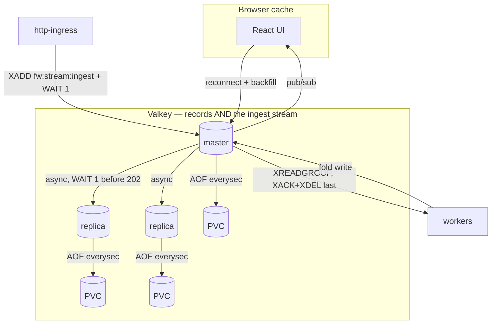

# Persistence and Durability

How R1 ("no data loss") is actually satisfied, and what it does not cover.

## 1. Where data can be lost

| # | Point | Loss possible | Mitigated by |
|---|---|---|---|
| 1 | Producer → nginx → http-ingress | yes, if 202 were sent early | 202 only after `EXEC` + `WAIT 1`; every failure is a retryable 503 and nginx buffers ([http-ingress.md](http-ingress.md) §2–3) |
| 2 | Ingress → stream (master memory) | yes, if the master dies before replicating | `WAIT 1` before 202 — the entry is on two pods |
| 3 | Stream → worker in-flight | no, the entry stays in the PEL until `XACK` | `XACK`+`XDEL` after the write; retry from the PEL; `XAUTOCLAIM` for dead workers ([workers.md](workers.md) §6) |
| 4 | Worker → fold write | no, the write happens before `XACK`+`XDEL` | [workers.md](workers.md) §3 |
| 4b | **Redelivered entry applied out of order** | yes, if closes were applied by read order | stream-entry timestamp + per-key watermark fold ([event-lifecycle.md](event-lifecycle.md) §4–5) |
| 5 | Stream trimmed / evicted | yes, if `MAXLEN` or an eviction policy were used | never trimmed; `maxmemory-policy noeviction` ([valkey.md](valkey.md) §5) |
| 6 | Valkey master → replicas | yes, async replication | `min-replicas-to-write 1` + `WAIT 1` at both producers + Sentinel; residual window in [fault-tolerance.md](fault-tolerance.md) §4 |
| 7 | Valkey memory → disk | **≤ 1 s** per pod with AOF `everysec` | AOF on **every** pod; the same write is in two pods' memory (§3) |
| 8 | Valkey disk → restore | yes, if the AOF is truncated | `aof-load-truncated yes`; the other pods hold the same data |
| 9 | Valkey → browser | yes, pub/sub is fire-and-forget | index backfill on reconnect |
| 10 | All three Valkey PVCs lost | **yes** | nothing inside the system — restore from a volume backup (§4) |

Points 1–5 and 9 are closed by design. Point 6 is bounded by `WAIT 1` and the write
gate. Point 7 is bounded by AOF on every pod. Point 10 is the one deliberate gap:
there is no copy outside Valkey any more.

## 2. The durability model



Every accepted (202'd) event exists in **at least two pods** at all times:

- after 202: the stream entry is in the master and in ≥ 1 replica (`WAIT 1`)
- after the worker's fold write: the record and its `hist:` row are written on the master, replicated, and only then is the stream entry removed

The only interval where a write exists solely in one pod's memory is between the
`XADD`/fold write and the `WAIT` / replication — and the producer has not been
answered yet in that interval. Each pod fsyncs its AOF within one second.

## 3. How "no data loss" is met

This is the key section.

> **A 202 means: the event is in the ingest stream on the master and on at least
> one replica, each of which persists it to its own AOF within one second, and it
> will stay there until a worker has folded it into the record.**

The guarantee rests on five mechanisms, all inside Valkey:

| # | Mechanism | Setting | What it buys |
|---|---|---|---|
| 1 | **AOF on every pod** | `appendonly yes`, `appendfsync everysec` in the one `valkey.conf` that master and both replicas load; each pod writes its own AOF to its own PVC | a restart of any pod, or of all three, reloads from disk; ≤ 1 s per pod not yet fsynced |
| 2 | **Replication** | 1 master + 2 replicas, anti-affined to different nodes | a lost pod or node loses no data |
| 3 | **Engine write gate** | `min-replicas-to-write 1`, `min-replicas-max-lag 10` | an isolated master (0 replicas) refuses writes with `NOREPLICAS` instead of accepting writes that a failover would discard |
| 4 | **Writers wait for a replica** | `WAIT 1` at http-ingress (and at the gateway's operator close) before answering | an acknowledged event is never only in the memory of a master that is about to die |
| 5 | **Remove last** | worker `XACK`+`XDEL` in one `MULTI` only after the fold write; no `MAXLEN`; `noeviction` | an entry cannot leave the stream unprocessed |

What the producer side adds: nginx treats 503 as retryable and buffers, so every
"not accepted" is retried until it is accepted.

### 3.1 Why the audit copies were dropped

The former message-broker design kept an audit queue and a journal audit exchange as a
write-ahead log outside Valkey. With the broker replaced by a Valkey stream, any audit
copy would live in the same database as the records — no failure independence,
double the memory. An external copy would need a second stateful system with its own
H/A and split-brain obligations. The decision was to drop the copies and rest
durability on mechanisms 1–5 ([roadmap.md](roadmap.md) §4).

What this costs, stated plainly:

| Lost capability | Consequence |
|---|---|
| Rebuild after **all three** Valkey PVCs are lost | no longer possible from inside the system; needs a volume backup (§4) |
| A per-delivery log outside Valkey | the `hist:` trail ([history.md](history.md)) covers 3 days, inside Valkey |
| A durable copy of journal notes outside Valkey | journal notes are as durable as any record — AOF on every pod + replication ([journal.md](journal.md)) |

### 3.2 What the AOF does and does not promise

| Claim | Holds |
|---|---|
| Every write is fsynced within 1 s, on every pod | yes, `appendfsync everysec` everywhere |
| A restart replays a small file | yes, because the rewrite rebuilds a compact base and the tail is capped at 32 MB |
| A torn write at the end of the log is tolerated | yes, `aof-load-truncated yes` |
| A promoted replica restarts from its own disk | yes, it has written its own AOF all along |
| Total PV loss (all 3 pods) is survivable | **no** — §4 |
| Deleted records stay deleted across a crash | **no** — the AOF still holds the write until the next rewrite ([acknowledge.md](acknowledge.md) §10.1) |

AOF is not a backup, and it is not an immediate eraser.

### 3.3 AOF and the original spec

| Spec text | Valkey |
|---|---|
| "use the AOF feature" | `appendonly yes` on every pod |
| "refresh that file with a new one from what's left once it reaches 32 MB" | `BGREWRITEAOF` at 32 MB of growth, from the live keyspace, forced by the `aof-rewriter` sidecar ([valkey.md](valkey.md) §4.2) |
| "to make restart and reread fast" | compact RDB-preamble base + ≤ 32 MB tail |
| "No data loss" | §3 above; total PVC loss excepted |

## 4. Total PVC loss

If the PVCs of all three Valkey pods are lost at once, the records, the `hist:`
trail, the journal and any not-yet-processed stream entries are gone. Nothing in the
cluster holds another copy. The remedies are outside this repo:

- storage-level snapshots / backups of the Valkey PVCs (CSI `VolumeSnapshot`, Velero), and
- producers that can re-send their current state.

Anti-affinity (3 nodes) and `minAvailable: 2` make the loss of all three volumes a
storage-backend failure, not an operational one.

## 5. Persistence strategy summary

| Setting | Value |
|---|---|
| Mechanism | AOF (`appendonly yes`) on master **and** replicas |
| fsync policy | `appendfsync everysec` — ≤ 1 s per pod |
| Base format | RDB preamble (`aof-use-rdb-preamble yes`) so replay starts from a compact image |
| Rewrite trigger | **32 MB of AOF growth** (`aof_current_size - aof_base_size`), enforced by the `aof-rewriter` sidecar |
| Engine auto-rewrite | **off** (`auto-aof-rewrite-percentage 0`). The engine has no "N bytes of growth" setting, and `0` disables rather than relaxes it ([valkey.md](valkey.md) §4.2) |
| RDB snapshots | **disabled** (`save ""`) — redundant with AOF, and each fork is a memory spike |
| Write gate | `min-replicas-to-write 1`, `min-replicas-max-lag 10` |
| Producer ack | `WAIT 1` (`FW_WAIT_REPLICAS`) before 202 |
| Restore | automatic on start: Valkey loads `/data/appendonlydir` |
| Torn tail | tolerated (`aof-load-truncated yes`), which is the correct trade at a 1 s fsync interval |

The 32 MB rotation is what makes a restart fast: a restart replays one snapshot plus
at most 32 MB of commands. Without it the AOF would be the whole 7-day write
history and a restart would replay all of it.

## 6. Restore procedure

```bash
# 1. restart Valkey: every pod loads its own AOF
kubectl -n fire-watch rollout restart statefulset/valkey
kubectl -n fire-watch rollout status statefulset/valkey

# 2. confirm data and the ingest stream came back
vk() { kubectl -n fire-watch exec valkey-0 -c valkey -- sh -c "valkey-cli -a \"\$VALKEY_PASSWORD\" --no-auth-warning $*"; }
vk ZCARD idx:event:all
vk XLEN fw:stream:ingest           # backlog left from before the restart
vk XINFO GROUPS fw:stream:ingest   # group 'workers' and its pending count survived

# 3. workers drain the backlog on their own: pending entries of the old pods are
#    XAUTOCLAIMed, new entries are read with '>'
```

The consumer group and its PEL are part of the stream key, so they are in the AOF
too: a restart does not lose track of which entries were delivered but not
acknowledged.

## 7. Durability acceptance checklist

- [ ] http-ingress answers 503, never 202, when no replica can acknowledge (drill in [validation.md](validation.md) §5)
- [ ] `WAIT` is issued with `FW_WAIT_REPLICAS=1` in production (`kubectl get deploy http-ingress -o yaml`)
- [ ] `CONFIG GET min-replicas-to-write` returns `1` on every pod, and `sentinel-bridge` has `FW_WRITE_GUARD_MIN_REPLICAS=1`
- [ ] Worker removes an entry only after the fold write returns OK (unit test + kill-during-write drill)
- [ ] `fw:stream:ingest` has no `MAXLEN` anywhere; `maxmemory-policy` is `noeviction`
- [ ] AOF is enabled and healthy **on every pod**: `INFO persistence` shows `aof_enabled:1` and
      `aof_last_write_status:ok` on valkey-0, -1 and -2 ([valkey.md](valkey.md) §8)
- [ ] Rotation runs: `aof_last_bgrewrite_status:ok`, the `aof-rewriter` sidecar's
      liveness probe is green, and its log shows the growth figure every interval
- [ ] A volume backup for the Valkey PVCs exists, or the total-PVC-loss gap (§4) is signed off
