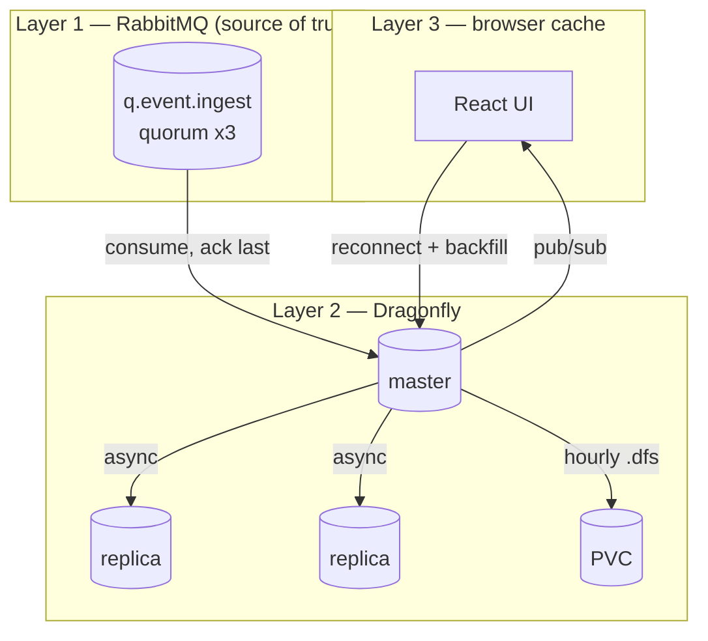

# Persistence and Durability

How R1 ("no data loss") is actually satisfied, and where the original spec cannot be satisfied.

## 1. Where data can be lost

| # | Point | Loss possible | Mitigated by |
|---|---|---|---|
| 1 | Producer → RabbitMQ | yes, if no publisher confirms | `confirm.select` + mandatory flag, see [rabbitmq.md](rabbitmq.md) §3 |
| 2 | RabbitMQ in-memory → journal | no, quorum queues fsync to 2/3 members before confirm | quorum queue + `default_queue_type` |
| 3 | RabbitMQ → worker in-flight | no, unacked messages are redelivered | manual ack after write |
| 4 | Worker → Dragonfly master | no, write happens before ack | [workers.md](workers.md) §3 |
| 4b | **Redelivered message applied out of order** | yes, if closes are applied by arrival order | broker timestamp + per-key watermark fold ([event-lifecycle.md](event-lifecycle.md) §4–5) |
| 5 | Dragonfly master → replicas | yes, async replication | quorum gate + Sentinel |
| 6 | Dragonfly memory → disk | **yes**, snapshot-only persistence | RabbitMQ replay, §4 |
| 7 | Dragonfly disk → restore | yes, if the snapshot is corrupt | 4-generation retention, [dragonfly.md](dragonfly.md) §6 |
| 8 | Dragonfly → browser | yes, pub/sub is fire-and-forget | index backfill on reconnect |

Points 1–4 and 8 are closed by design. Points 5 and 6 are where the original spec assumed AOF.

## 2. The three-layer durability model



Every accepted event exists in **at least two independent places** at all times:

- after publish: RabbitMQ quorum (2/3 on disk)
- after worker write: RabbitMQ (unacked) + Dragonfly memory, and after ack: Dragonfly memory + 2 replicas

The only interval where an event exists solely in Dragonfly memory is the TTL window after ack ([sizing.md](sizing.md) §1). That interval is exactly what the hourly snapshot reduces from "everything since last restart" to "at most 60 minutes".

## 3. AOF is not available — explicit finding

Upstream Dragonfly documentation, page *Append Only File (AOF)*:

> "Currently, Dragonfly does not support AOF. The primary reason is the lack of high-priority demand within the community. Implementing AOF in Dragonfly would require a different approach than in Redis and is more sophisticated, especially in terms of maintaining high performance."

Consequences for this project:

| Spec text | Status |
|---|---|
| "Dragonfly shall use AOF feature" | **Impossible as written** |
| "every hour refresh that file with a new one from what's left in Dragonfly" | Achievable in spirit via `snapshot_cron` (fresh complete snapshot hourly) |
| "to make restart and reread fast" | Achievable — restart loads one recent complete snapshot, not a long log |
| "No data loss" | Achievable only with §4, not with any Dragonfly persistence feature |

Options, in order of preference:

1. **RabbitMQ as WAL (recommended).** Keep an ack'd-event journal replayable from RabbitMQ for the full Dragonfly TTL window. No new component, no new failure mode.
2. **Accept a bounded RPO** of up to 60 minutes and record it as a documented deviation from R1. Requires the owner's sign-off.
3. **Change datastore** to Valkey/Redis with AOF — contradicts the spec's Dragonfly requirement, so out of scope unless the owner reopens it.

This document assumes option 1.

## 4. RabbitMQ as write-ahead log

### 4.1 Design

Events are acknowledged by the worker, so RabbitMQ would normally forget them. To keep a replayable log, the worker publishes a copy to an **audit stream** before acking:

```text
worker:
  validate
  compress payload.msgc (payload-and-compression.md)
  write fw:evt:{id} + ZADD index + alert-fold   (Dragonfly master, compressed)
  publish to fx.audit (stream-backed queue q.audit.events, quorum, PLAIN)
  ack the ingest message
```

The audit copy is deliberately **plain**, so the WAL never depends on the application's compression codec ([payload-and-compression.md](payload-and-compression.md) §3.1).

`q.audit.events` properties:

| Property | Value |
|---|---|
| type | quorum queue, durable |
| `x-message-ttl` | **7 days** — matches Dragonfly retention exactly |
| `x-max-length-bytes` | 64GiB — hard backstop (~19.3 GiB of real data at 1 000/min × 2 048 B) |
| `x-overflow` | `reject-publish` — never silently drop the newest events |
| consumers | none in steady state |

A dedicated **replay job** (a `Job`, not a Deployment) drains `q.audit.events` and re-writes records into Dragonfly:

```text
replay --since <timestamp> --until <timestamp>
  -> consume non-destructively (basic.consume + nack requeue, or a shadow consumer group)
  -> SET fw:evt:{id} ... + ZADD fw:idx:src:{source} ... + alert-fold
  -> copy timestamp_in_ms into x-original-ts on any republish
  -> stop, leaving the audit queue intact
```

`x-message-ttl: 7d` and `x-overflow: reject-publish` together matter: without the TTL the queue never self-trims (no consumers) and eventually hits the byte cap, stalling ingest permanently; without `reject-publish` a full queue would silently drop the newest events. With both, the WAL is a bounded rolling 7-day window, and overflowing it produces backpressure instead of loss.

### 4.2 Replay triggers

| Situation | Action |
|---|---|
| Dragonfly restarted and loaded a snapshot | replay `now - 60min` (covers the snapshot gap) |
| Dragonfly PVC lost / snapshot corrupt | replay the **full 7 days** from `q.audit.events` |
| Replica divergence discovered after failover | replay the failover window |
| Deliberate rebuild | replay full window, then drain |

### 4.3 Cost

- One extra publish per event (cheap, same broker connection, same confirm).
- ≈2.75 GiB/day of RabbitMQ storage at 1 000/min × 2 048 B; the 64GiB cap is ~3.3x slack.
- A periodic replay is not required in steady state; only on recovery.

Rejected alternative: a separate WAL database (Kafka, another Postgres). It adds a fourth stateful component with its own H/A and split-brain obligations, for a job RabbitMQ already does with quorum queues.

### 4.3.1 Replay must preserve timestamps

A replay that stamps records with "now" would make seven days of old CLOSE events look newer than any live alert and could retire active alarms. The replay job therefore copies the original broker timestamp into `x-original-ts` on republish, and workers prefer that header ([event-lifecycle.md](event-lifecycle.md) §6). Combined with the per-key watermark fold, a replay is **order-insensitive**: it reconstructs the same alert state regardless of record order.

### 4.4 WAL and retention now have the same window

Because the sustained rate is 1 000/min, the audit queue can afford to keep history for the **full 7 days**, which means the two promises finally line up:

| Promise | Held where | Window | Survives |
|---|---|---|---|
| **No accepted event is lost** (R1) | RabbitMQ audit queue | 7 days | master loss, replica loss, full cluster power loss, snapshot corruption, **total PVC loss** |
| **7 days of history is queryable** (product) | Dragonfly RAM + hourly snapshot | 7 days | pod restart, master failover, and (via replay) PVC loss |

This is a meaningful improvement over the higher-rate design: a complete wipe of all three Dragonfly PVCs is now fully recoverable, not partially. The cost is ≈19.3 GiB of RabbitMQ disk.

Constraint to keep in mind: **if the sustained rate grows, this parity breaks.** At 5 000/min the WAL needs ≈96 GiB, at 10 000/min ≈193 GiB. Re-check [sizing.md](sizing.md) §3.6 whenever the rate assumption changes.

## 5. Snapshot strategy summary

| Setting | Value |
|---|---|
| Format | `.dfs` (`--df_snapshot_format=true`) |
| Schedule | `snapshot_cron=0 * * * *` |
| Naming | `firewatch-{timestamp}` (lexicographically sortable) |
| Retention | newest 4 sets, pruner sidecar every 10 min |
| Save on shutdown | enabled (`--dbfilename` non-empty) |
| Restore | automatic on start: Dragonfly loads the newest snapshot in `--dir` |
| Verification | startup probe tolerates a multi-minute load |

RDB is not used: `.dfs` is forkless and sharded, so an hourly 6 GiB snapshot does not stall the event loop the way a `fork()`-based RDB save would.

## 6. Restore procedure

```bash
# 1. stop writers so the replay is the single writer
kubectl -n fire-watch scale deploy/worker --replicas=0

# 2. start Dragonfly: newest .dfs auto-loads
kubectl -n fire-watch rollout restart statefulset/dragonfly
kubectl -n fire-watch exec dragonfly-0 -- redis-cli -p 6379 DBSIZE

# 3. replay the gap from the audit queue
kubectl -n fire-watch create job --from=cronjob/replay-gap replay-$(date +%s)

# 4. verify counts against the audit queue's expected window, then resume writers
kubectl -n fire-watch scale deploy/worker --replicas=3
```

Verification metric: `DBSIZE` after replay must be >= the number of distinct event ids read from `q.audit.events` for the same window.

## 7. Durability acceptance checklist

- [ ] Publishers use confirms (verified by a deliberate broker kill during publish)
- [ ] `q.event.ingest` is a quorum queue with 3 members (verified in [rabbitmq.md](rabbitmq.md) §9)
- [ ] Worker acks only after the Dragonfly write returns OK (unit test + kill-during-write test)
- [ ] `q.audit.events` receives a copy before ack (verified by inspecting queue depth growth)
- [ ] Hourly snapshots exist and are pruned to 4 ([dragonfly.md](dragonfly.md) §8)
- [ ] A full Dragonfly PVC wipe can be recovered from `q.audit.events` ([validation.md](validation.md) §5)
- [ ] RPO deviation (if option 2 is chosen instead) is recorded and signed off
