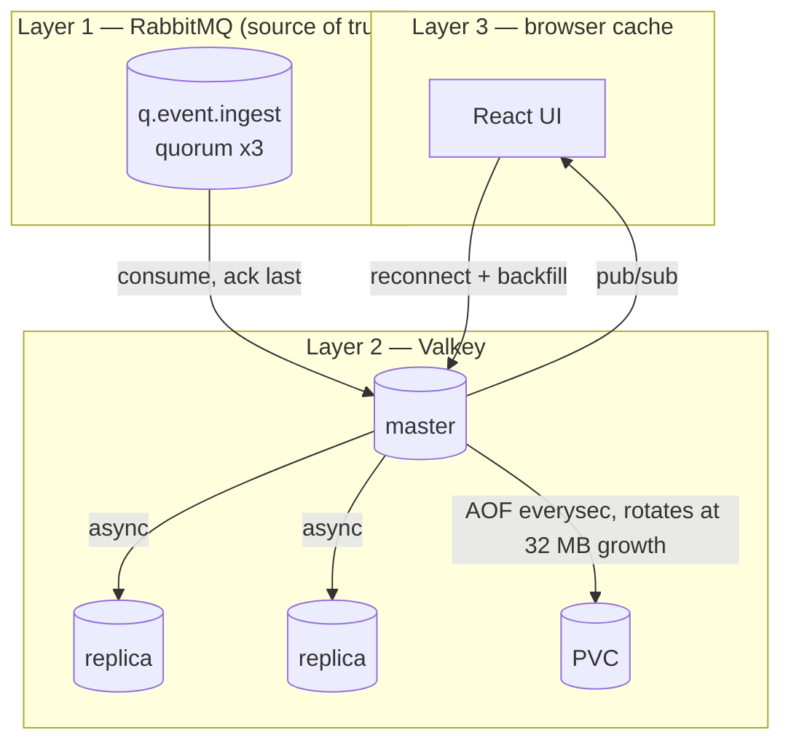

# Persistence and Durability

How R1 ("no data loss") is actually satisfied, and where the original spec cannot be satisfied.

## 1. Where data can be lost

| # | Point | Loss possible | Mitigated by |
|---|---|---|---|
| 1 | Producer → RabbitMQ | yes, if no publisher confirms | `confirm.select` + mandatory flag, see [rabbitmq.md](rabbitmq.md) §3 |
| 2 | RabbitMQ in-memory → journal | no, quorum queues fsync to 2/3 members before confirm | quorum queue + `default_queue_type` |
| 3 | RabbitMQ → worker in-flight | no, unacked messages are redelivered | manual ack after write |
| 4 | Worker → Valkey master | no, write happens before ack | [workers.md](workers.md) §3 |
| 4b | **Redelivered message applied out of order** | yes, if closes are applied by arrival order | broker timestamp + per-key watermark fold ([event-lifecycle.md](event-lifecycle.md) §4–5) |
| 5 | Valkey master → replicas | yes, async replication | quorum gate + Sentinel |
| 6 | Valkey memory → disk | **≤ 1 s** with AOF `everysec` | AOF + RabbitMQ replay, §3 |
| 7 | Valkey disk → restore | yes, if the AOF is truncated | `aof-load-truncated yes`, plus RabbitMQ replay |
| 8 | Valkey → browser | yes, pub/sub is fire-and-forget | index backfill on reconnect |

Points 1–4 and 8 are closed by design. Point 5 (async replication) is bounded by the
write gate. Point 6 is now bounded by AOF instead of by the snapshot interval — the
change Valley made worthwhile.

## 2. The three-layer durability model



The third copy — the AOF on the PV — is what Dragonfly could not provide.

Every accepted event exists in **at least two independent places** at all times:

- after publish: RabbitMQ quorum (2/3 on disk)
- after worker write: RabbitMQ (unacked) + Valkey memory, and after ack: Valkey memory + 2 replicas

The only interval where a record exists solely in Valkey memory is after the ack and
before the next AOF fsync. With `appendfsync everysec` that is **at most one second**
([valkey.md](valkey.md) §4.1) — not the up-to-60-minutes the snapshot design accepted.

## 3. AOF is available again — what changed

The Dragonfly-era audit recorded that the requirement

> "use the AOF feature, but every hour refresh that file with a new one from what's
> left in the datastore"

could **not** be met, because Dragonfly has no AOF implementation. Valkey does, so the
requirement is now satisfied as written:

| Spec text | Dragonfly | Valkey |
|---|---|---|
| "use the AOF feature" | not implemented | `appendonly yes` |
| "every hour refresh that file with a new one from what's left" | approximated by `snapshot_cron` | `BGREWRITEAOF` at 32 MB of growth, from the live keyspace ([valkey.md](valkey.md) §4.2) |
| "to make restart and reread fast" | met (fresh snapshot) | met (compact RDB-preamble base + ≤ 1 h tail) |
| "No data loss" | only via RabbitMQ replay | AOF bounds it to ≤ 1 s, and RabbitMQ replay still covers a total PV loss |

### 3.1 What the AOF does and does not promise

| Claim | Holds |
|---|---|
| Every write is fsynced within 1 s | yes, `appendfsync everysec` |
| A restart replays a small file | yes, because the rewrite rebuilds a compact base and the tail is capped at 32 MB |
| A torn write at the end of the log is tolerated | yes, `aof-load-truncated yes` |
| Total PV loss is survivable | **no** — that is what `q.audit.events` is for (§4) |
| Deleted records stay deleted across a crash | **no** — the AOF still holds the write until the next rewrite ([acknowledge.md](acknowledge.md) §10.1) |

The last two are the ones worth remembering. AOF is not a backup, and it is not an
immediate eraser.

## 4. RabbitMQ as write-ahead log

### 4.1 Design

Events are acknowledged by the worker, so RabbitMQ would normally forget them. To keep a replayable log, the worker publishes a copy to an **audit stream** before acking:

```text
worker:
  validate
  compress payload.msgc (payload-and-compression.md)
  EVAL event-fold.lua (record + 4 indexes + rollup)   (Valkey master, compressed)
  publish to fx.audit (stream-backed queue q.audit.events, quorum, PLAIN)
  ack the ingest message
```

The audit copy is deliberately **plain**, so the WAL never depends on the application's compression codec ([payload-and-compression.md](payload-and-compression.md) §3.1).

`q.audit.events` properties:

| Property | Value |
|---|---|
| type | quorum queue, durable |
| `x-message-ttl` | **7 days** — matches Valkey retention exactly |
| `x-max-length-bytes` | 64GiB — hard backstop (~19.3 GiB of real data at 1 000/min × 2 048 B) |
| `x-overflow` | `reject-publish` — never silently drop the newest events |
| consumers | none in steady state |

A dedicated **replay job** (a `Job`, not a Deployment) drains `q.audit.events` and re-writes records into Valkey:

```text
replay --since <timestamp> --until <timestamp>
  -> consume non-destructively (basic.consume + nack requeue, or a shadow consumer group)
  -> EVAL event-fold.lua (one atomic step: hash, indexes, rollup)
  -> copy timestamp_in_ms into x-original-ts on any republish
  -> stop, leaving the audit queue intact
```

`x-message-ttl: 7d` and `x-overflow: reject-publish` together matter: without the TTL the queue never self-trims (no consumers) and eventually hits the byte cap, stalling ingest permanently; without `reject-publish` a full queue would silently drop the newest events. With both, the WAL is a bounded rolling 7-day window, and overflowing it produces backpressure instead of loss.

### 4.2 Replay triggers

| Situation | Action |
|---|---|
| Valkey restarted from its AOF | replay nothing — `appendfsync everysec` bounds the gap to ≤ 1 s |
| Valkey PVC lost / AOF unreadable | replay the **full 7 days** from `q.audit.events` |
| Replica divergence discovered after failover | replay the failover window |
| Deliberate rebuild | replay full window, then drain |

### 4.3 Cost

- One extra publish per event (cheap, same broker connection, same confirm).
- ≈2.75 GiB/day of RabbitMQ storage at 1 000/min × 2 048 B; the 64GiB cap is ~3.3x slack.
- A periodic replay is not required in steady state; only on recovery.

Rejected alternative: a separate WAL database (Kafka, another Postgres). It adds a fourth stateful component with its own H/A and split-brain obligations, for a job RabbitMQ already does with quorum queues.

### 4.3.1 Replay must preserve timestamps

A replay that stamps records with "now" would make seven days of old CLOSE events look newer than any live alert and could retire active alarms. The replay job therefore copies the original broker timestamp into `x-original-ts` on republish, and workers prefer that header ([event-lifecycle.md](event-lifecycle.md) §6). Combined with the per-key watermark fold, a replay is **order-insensitive**: it reconstructs the same alert state regardless of record order.

### 4.4 WAL and retention now have the same window

Because the sustained rate is 1 000/min, the audit queue can afford to keep history for the **full 7 days**, which means the two promises finally line up:

| Promise | Held where | Window | Survives |
|---|---|---|---|
| **No accepted event is lost** (R1) | RabbitMQ audit queue | 7 days | master loss, replica loss, full cluster power loss, AOF corruption, **total PVC loss** |
| **7 days of history is queryable** (product) | Valkey RAM + AOF | 7 days | pod restart, master failover, and (via replay) PVC loss |

This is a meaningful improvement over the higher-rate design: a complete wipe of all three Valkey PVCs is now fully recoverable, not partially. The cost is ≈19.3 GiB of RabbitMQ disk.

Constraint to keep in mind: **if the sustained rate grows, this parity breaks.** At 5 000/min the WAL needs ≈96 GiB, at 10 000/min ≈193 GiB. Re-check [sizing.md](sizing.md) §3.6 whenever the rate assumption changes.

## 5. Persistence strategy summary

| Setting | Value |
|---|---|
| Mechanism | AOF (`appendonly yes`) |
| fsync policy | `appendfsync everysec` — ≤ 1 s RPO |
| Base format | RDB preamble (`aof-use-rdb-preamble yes`) so replay starts from a compact image |
| Rewrite trigger | **32 MB of AOF growth** (`aof_current_size - aof_base_size`), enforced by the `aof-rewriter` sidecar |
| Engine auto-rewrite | **off** (`auto-aof-rewrite-percentage 0`). The engine has no "N bytes of growth" setting, and `0` disables rather than relaxes it ([valkey.md](valkey.md) §4.2) |
| RDB snapshots | **disabled** (`save ""`) — redundant with AOF, and each fork is a memory spike |
| Restore | automatic on start: Valkey loads `/data/appendonlydir` |
| Torn tail | tolerated (`aof-load-truncated yes`), which is the correct trade at a 1 s fsync interval |

The 32 MB rotation is what makes a restart fast: a restart replays one snapshot plus
at most 32 MB of commands. Without it the AOF would be the whole 7-day write
history and a restart would replay all of it.

## 6. Restore procedure

```bash
# 1. stop writers so the replay is the single writer
kubectl -n fire-watch scale deploy/worker --replicas=0

# 2. start Valkey: the AOF auto-loads
kubectl -n fire-watch rollout restart statefulset/valkey
kubectl -n fire-watch exec valkey-0 -- valkey-cli -p 6379 ZCARD idx:event:all

# 3. replay the gap from the audit queue — only needed if the AOF was lost
kubectl -n fire-watch create job --from=cronjob/replay-gap replay-$(date +%s)

# 4. verify counts against the audit queue's expected window, then resume writers
kubectl -n fire-watch scale deploy/worker --replicas=3
```

Verification metric: `ZCARD idx:event:all` after replay must be >= the number of
distinct conditions read from `q.audit.events` for the same window. Note that it can
be **smaller** than the number of MESSAGES, because a repeat folds onto the same
record ([valkey.md](valkey.md) §2).

## 7. Durability acceptance checklist

- [ ] Publishers use confirms (verified by a deliberate broker kill during publish)
- [ ] `q.event.ingest` is a quorum queue with 3 members (verified in [rabbitmq.md](rabbitmq.md) §9)
- [ ] Worker acks only after the Valkey write returns OK (unit test + kill-during-write test)
- [ ] `q.audit.events` receives a copy before ack (verified by inspecting queue depth growth)
- [ ] AOF is enabled and healthy: `INFO persistence` shows `aof_enabled:1` and
      `aof_last_write_status:ok` ([valkey.md](valkey.md) §8)
- [ ] Rotation runs: `aof_last_bgrewrite_status:ok`, the `aof-rewriter` sidecar's
      liveness probe is green, and its log shows the growth figure every interval
- [ ] A full Valkey PVC wipe can be recovered from `q.audit.events` ([validation.md](validation.md) §5)
- [ ] RPO deviation (if option 2 is chosen instead) is recorded and signed off
