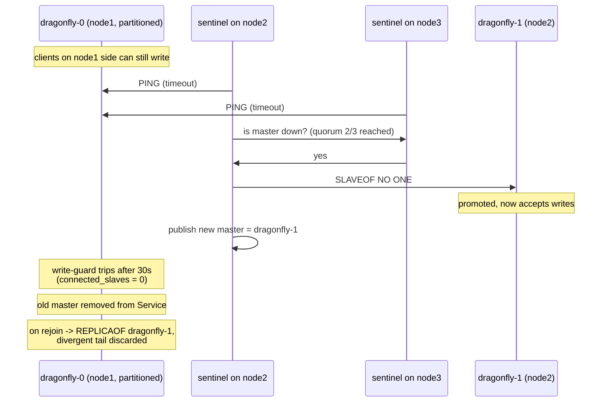

# Redis Sentinel

Purpose: provide master discovery and failover for DragonflyDB without the Dragonfly operator.

## 1. Why Sentinel at all

Dragonfly provides a primary-replica data plane but no control plane: it will not detect that the master died, will not promote a replica, and will not tell clients where the new master is. The Dragonfly operator normally fills that gap; it is off the table. Redis Sentinel is the standard, battle-tested substitute and speaks plain RESP, so it works against Dragonfly unchanged.

| Feature needed | Dragonfly server | Sentinel |
|---|---|---|
| Replicate data | yes | n/a |
| Detect master failure | no | yes |
| Promote replica | no (only on command) | yes |
| Tell clients the master address | no | yes |
| Handle split brain | no | yes, via quorum |

## 2. Topology

| Item | Value |
|---|---|
| Image | `docker.io/library/redis:7.4` (Sentinel mode; pin a digest) |
| Kind | `StatefulSet`, 3 replicas, `podManagementPolicy: OrderedReady` |
| Command | `redis-sentinel /data/sentinel.conf` |
| Service | `sentinel-headless` — `clusterIP: None` |
| Port | 26379 |
| Storage | **1Gi PVC per pod** — `sentinel.conf` must persist ([§3.2](../docs/fault-tolerance.md)) |
| Anti-affinity | **required** against `app.kubernetes.io/name=sentinel`, `topologyKey: kubernetes.io/hostname` |
| PDB | `minAvailable: 2` |

**The config must be persistent — this was originally specified as `emptyDir` and that was a defect.** Sentinel stores a monotonically increasing **config epoch** in `sentinel.conf` and uses it to reject stale failover votes. With an ephemeral file, a restarted sentinel advertises epoch 0 and can vote for a *second* failover while the first is still propagating — two masters, which is precisely the split brain the quorum exists to prevent. Losing the topology is recoverable; losing the epoch is not. See [fault-tolerance.md](fault-tolerance.md) §3.2.

## 3. Configuration

```conf
# sentinel.conf (ConfigMap: sentinel-config, copied to /data on first boot only)
port 26379
dir /data
sentinel resolve-hostnames yes
sentinel announce-hostnames yes
sentinel monitor fire-watch-dragonfly dragonfly-0.dragonfly-headless.fire-watch.svc.cluster.local 6379 2
sentinel auth-pass fire-watch-dragonfly ${DRAGONFLY_PASSWORD}
sentinel down-after-milliseconds fire-watch-dragonfly 5000
sentinel failover-timeout fire-watch-dragonfly 60000
sentinel parallel-syncs fire-watch-dragonfly 1
sentinel deny-scripts-reconfig yes
```

The init container copies the ConfigMap to `/data/sentinel.conf` **only if the file does not already exist**, so Sentinel's own `+config-rewrite` survives pod restarts. Sentinel rewrites this file on every failover — an init container that overwrote it unconditionally would reset the config epoch on every restart.

Key parameters:

| Parameter | Value | Rationale |
|---|---|---|
| `quorum` | `2` | Of 3 sentinels, 2 must agree a master is down. Prevents one flaky sentinel from triggering failover. |
| `down-after-milliseconds` | `5000` | Fast enough to keep write stalls short; not so fast that a GC pause causes a spurious failover. |
| `failover-timeout` | `60000` | Caps how long a stuck failover can block a retry. |
| `parallel-syncs` | `1` | Reconciling one replica at a time keeps read capacity while the other replica is still stale. |
| `resolve-hostnames` / `announce-hostnames` | `yes` | Essential: Sentinel otherwise reports bare IPs, which are unstable in K8s. |

Sentinel rewrites its config on failover, so the file must live on a writable, **persistent** volume. The ConfigMap is copied in by an init container only when absent (§2).

## 4. The role-application problem (and its solution)

Sentinel can promote a replica, but the promoted pod is still `dragonfly-2`, i.e. behind a stable DNS name that other manifests hard-coded as a replica. Two gaps remain:

1. Client-facing Service must point at the current master.
2. A restarted pod must rejoin as a replica of the current master, not of `dragonfly-0`.

Both are closed by one small controller, `sentinel-bridge` — a Deployment with **2 replicas** and `coordination.k8s.io/v1` `Lease` leader election, spread by required anti-affinity. Only the lease holder acts; the standby takes over within one lease duration (15s). A single-replica bridge would be a single point of failure for master discovery ([fault-tolerance.md](fault-tolerance.md) §3.5).

**Implemented:** [services/sentinel-bridge](../services/sentinel-bridge/) — source, tests, container config and the full env reference.

```text
loop every 5s:
  master := SENTINEL get-master-addr-by-name fire-watch-dragonfly
  role   := sentinel report of each pod (SENTINEL replicas fire-watch-dragonfly)
  patch Service/dragonfly selector -> pod of master   (by resolving pod DNS -> endpoint)
  for each replica: if its reported master != master -> REPLICAOF master 6379
  if master pod is not reachable        -> SENTINEL failover fire-watch-dragonfly
```

Why a controller and not `--replicaof` in the manifest: a hard-coded `--replicaof dragonfly-0` makes every pod boot believing it is subordinate to `-0`. After a failover that is wrong, and the pod would wipe its data and full-sync from a demoted node.

Alternative considered and rejected: giving each pod a startup script that asks Sentinel for the master. It works, but only at boot — it cannot fix the Service selector, and it re-introduces an ordering dependency on Sentinel readiness.

### 4.1 Two lease defects that made leadership impossible

`sentinel-bridge` was `1/1 Running` and serving `/readyz: ready` while holding **no
lease at all**. Both causes are in `@kubernetes/client-node` interop, and both were
masked by error handling that treated real faults as benign races.

**Lease times are `MicroTime`, not millisecond RFC3339.** `spec.acquireTime` and
`spec.renewTime` must carry **exactly six** fractional digits. `Date#toISOString()`
emits three, and the API server rejects the body:

```
400 BadRequest: Lease in version "v1" cannot be handled as a Lease:
    parsing time "...58.666Z" as "2006-01-02T15:04:05.000000Z07:00":
    cannot parse ".666Z" as ".000000"
```

Format with `d.toISOString().replace(/\.(\d{3})Z$/, '.$1000Z')`. JS has only
millisecond resolution, so pad rather than imply finer precision.

**`readNamespacedLease` resolves to an envelope, not the object.** In
`@kubernetes/client-node` 0.22.x the call is positional
(`readNamespacedLease(name, namespace, ...)`) *and* returns
`{ response, body }`. Code that consumed the promise directly got an object with no
`spec`, which reads as "another replica holds an expired lease", so every cycle took
the takeover path and replaced the Lease with a metadata-less body:

```
400 BadRequest: the name of the object (… based on URL) was undeterminable: name must be provided
```

Return `res?.body ?? res` so a future client upgrade cannot silently break it.

**Why it was invisible.** Every lease failure was logged at `debug` as
`lease create race lost`, and `/readyz` reports readiness for a standby by design —
so the process looked healthy and reported `ready`. Two rules follow:

- Only an HTTP **409** is a lost race. Everything else is a fault and must be logged
  at `error` and rethrown.
- Readiness deliberately does **not** prove leadership (a standby is ready), so
  leadership must be verified from the cluster: `kubectl get lease
  sentinel-bridge-leader` must exist and name the current pod.

## 5. Client behaviour

Workers and gateways connect through a Sentinel-aware client:

| Language | Library | Mechanism |
|---|---|---|
| Node.js | `ioredis` | `new Redis({ sentinels: [...], name: 'fire-watch-dragonfly' })` |
| Go (if used) | `go-redis` | `redis.NewFailoverClient` |
| Python (if used) | `redis-py` | `redis.sentinel.Sentinel(...).master_for(...)` |

Hard rules:

- **Never** use `dragonfly-0.dragonfly-headless...` or any pod IP as a connection target in application code.
- Use Sentinel-aware clients, or the `dragonfly` Service (whose selector the bridge keeps correct). Sentinel-aware is preferred: it survives the up-to-5s window where the Service still points at the old master.
- Enable `retry_strategy` / reconnect with exponential backoff; a failover causes at most a few seconds of `READONLY` or connection errors.

## 6. Split-brain walkthrough

Scenario: `node1` is partitioned from `node2` and `node3`. `dragonfly-0` runs on `node1`.



Outcomes:

| Guarantee | Status |
|---|---|
| Two masters accepting routed writes | Prevented (quorum 2/3 + write guard) |
| Writes on the minority side reachable from workers | Prevented (workers use Sentinel/Service) |
| Writes on the minority side that bypass routing | **Possible** — accepted, documented in [dragonfly.md](dragonfly.md) §3 |
| Data loss on the minority side | Yes, by design: un-replicated writes are discarded on rejoin. This is the correct choice under R1, since keeping them would require conflicting merge semantics. |
| Data loss for events already in RabbitMQ | None ([persistence-and-durability.md](persistence-and-durability.md) §4) |

## 7. Monitoring

Sentinel speaks RESP on 26379 and has **no HTTP endpoint**, so Prometheus cannot scrape it directly. A `redis-exporter` Deployment bridges that ([k8s/base/33-redis-exporter.yaml](../k8s/base/33-redis-exporter.yaml)). Rules are in [k8s/base/60-monitoring.yaml](../k8s/base/60-monitoring.yaml).

| Signal | Alert |
|---|---|
| `redis_sentinel_master_status{master_name="fire-watch-dragonfly"}` | `!= 1` for 2 min |
| sentinel count reporting the master | `< 2` for 5 min — quorum is lost, no failover possible |
| `redis_sentinel_master_role_changes_total` | `> 2` per hour — failover flapping |
| `redis_sentinel_master_status` series count | `!= 3` for 5 min |
| pod label `fire-watch.io/writable=false` | `> 0` for 5 min (same signal as Dragonfly §7) |

`redis_sentinel_*` metric names come from the exporter, not from Sentinel itself, and they vary by exporter version. Verify against the running exporter before trusting the rules:

```bash
kubectl -n fire-watch exec deploy/redis-exporter -- wget -qO- localhost:9121/metrics | grep sentinel
```

## 8. Verification checklist

```bash
kubectl -n fire-watch exec sentinel-0 -- redis-cli -p 26379 SENTINEL masters
# expect: name fire-watch-dragonfly, flags master, num-slaves 2, num-other-sentinels 2, quorum 2
kubectl -n fire-watch exec sentinel-0 -- redis-cli -p 26379 SENTINEL replicas fire-watch-dragonfly
# expect: 2 replicas with master-link-status ok
kubectl -n fire-watch exec sentinel-0 -- redis-cli -p 26379 SENTINEL get-master-addr-by-name fire-watch-dragonfly
kubectl -n fire-watch get endpoints dragonfly   # must list exactly the master pod IP

# forced failover rehearsal
kubectl -n fire-watch exec sentinel-0 -- redis-cli -p 26379 SENTINEL failover fire-watch-dragonfly
kubectl -n fire-watch exec sentinel-0 -- redis-cli -p 26379 SENTINEL get-master-addr-by-name fire-watch-dragonfly
# expect: a different pod IP within ~10s; Service selector follows within 5s
```
